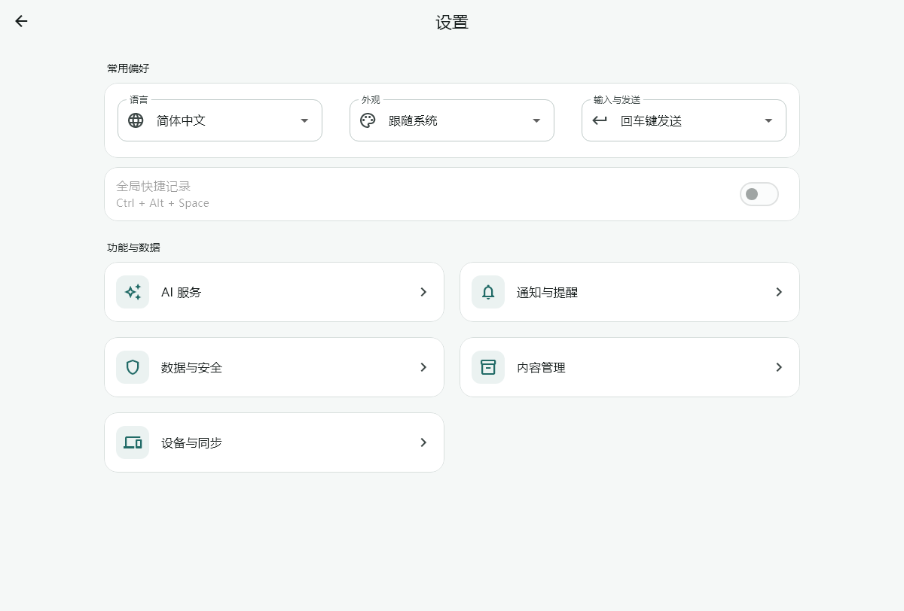
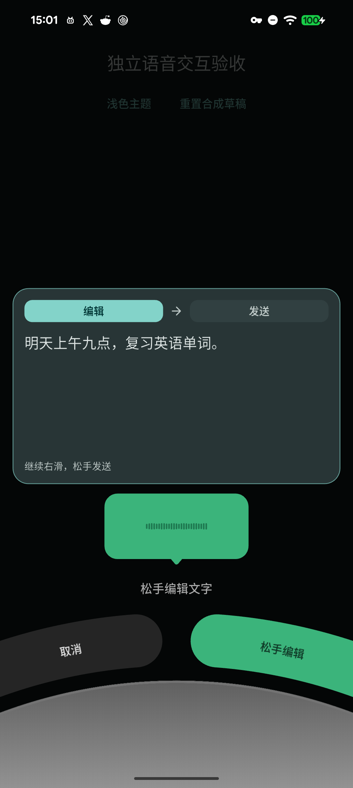
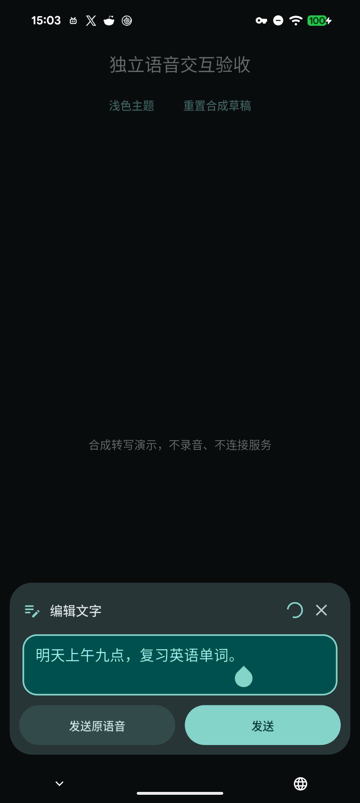
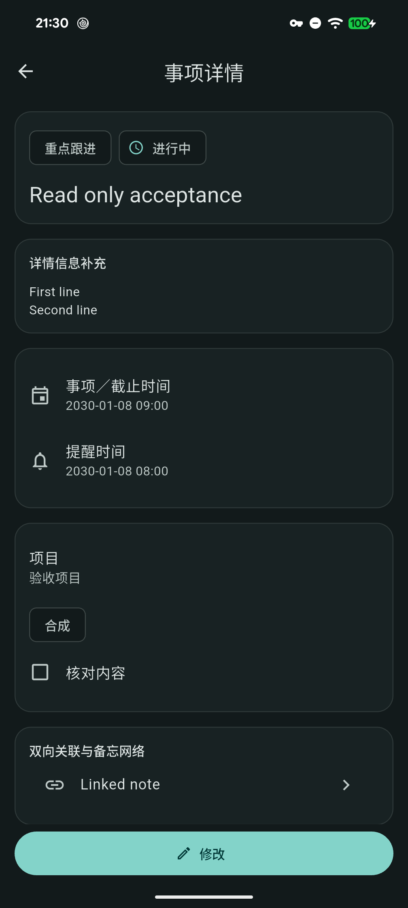
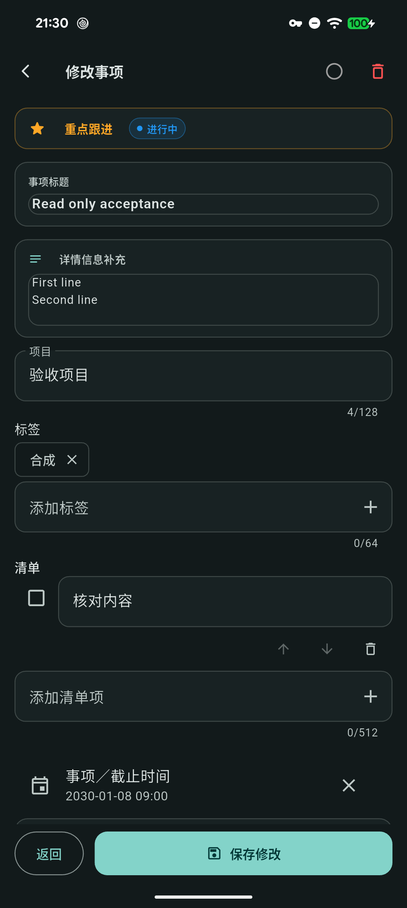
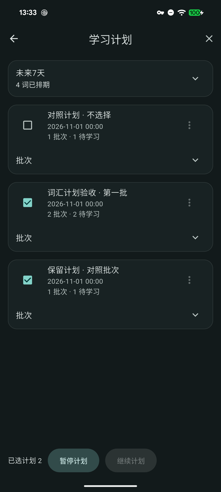
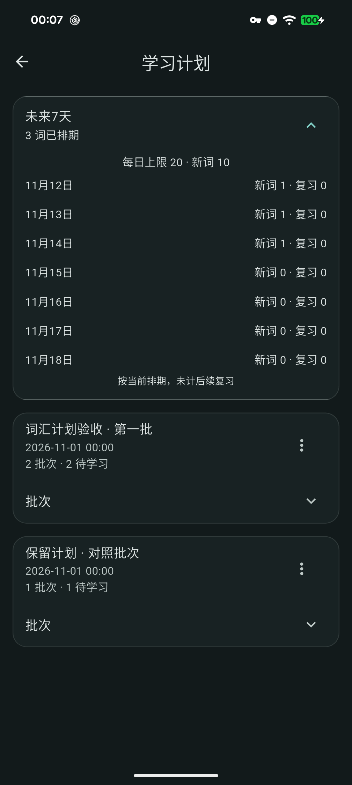
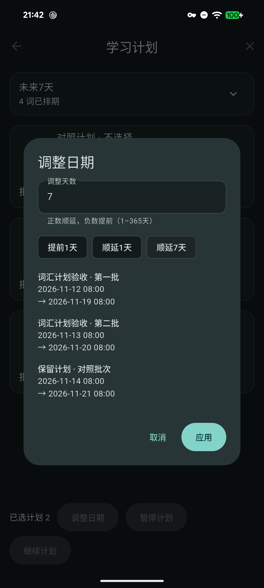
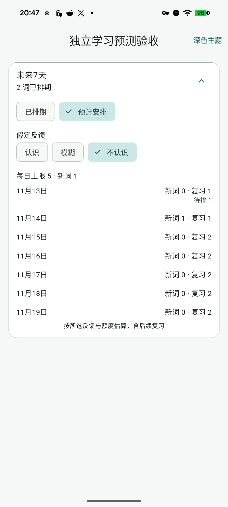

<div align="center">

# 别忘了 · DontForget

**随手记录，有序跟进。**

本地优先的备忘与任务工作台，让文字、录音、附件和学习计划各有归处。

[](https://github.com/yarnway/dontforget/releases/tag/v1.8.10)
[](https://github.com/yarnway/dontforget/actions/workflows/build_and_release.yml)
[](https://flutter.dev)
[](#下载)

[下载](#下载) · [功能](#功能) · [快速开始](#快速开始) · [开发](#开发) · [文档](#文档)

</div>

<picture>
  <source media="(prefers-color-scheme: dark)" srcset="docs/images/settings-desktop-dark.png">
  
</picture>

<p align="center"><sub>界面示例 · 合成数据 · 支持明亮、暗黑与跟随系统</sub></p>

## 下载

**当前稳定版：v1.8.10 · build79**　[发行说明与校验文件](https://github.com/yarnway/dontforget/releases/tag/v1.8.10)

| 平台 | 下载 | 运行基线 |
| :--- | :--- | :--- |
| Windows x64 | [安装版 EXE](https://github.com/yarnway/dontforget/releases/download/v1.8.10/DontForget_Setup_v1.8.10.exe) · [便携版 ZIP](https://github.com/yarnway/dontforget/releases/download/v1.8.10/DontForget_Windows_Portable_v1.8.10.zip) | Windows 10 / 11 |
| Android | [ARM64 APK（推荐）](https://github.com/yarnway/dontforget/releases/download/v1.8.10/DontForget_Android_arm64_v1.8.10.apk) · [通用 APK](https://github.com/yarnway/dontforget/releases/download/v1.8.10/DontForget_Android_v1.8.10.apk) | Android 7.0 / API 24 起 |
| Linux x64 | [归档 TAR.GZ](https://github.com/yarnway/dontforget/releases/download/v1.8.10/DontForget_Linux_x64_v1.8.10.tar.gz) | Ubuntu 24.04 基线 |

常见64位安卓手机推荐 ARM64 APK，较同版通用包缩小约65%；其他架构使用通用包。Android [AAB](https://github.com/yarnway/dontforget/releases/download/v1.8.10/DontForget_Android_v1.8.10.aab) 供分发使用，不能直接安装。macOS、iOS 工程保留，签名与设备验收继续推进。Windows 当前未做 Authenticode 签名；Linux 运行依赖见[安装指南](docs/Packaging_and_Deployment.md)。

下载后可用 Release 中的 `SHA256SUMS.txt` 核对文件。便携版指免安装启动，业务数据仍存放在平台应用目录；迁移数据请使用备份功能。[已验范围与已知限制](docs/Release_1.8.10_79_2026-11-15.md)单独记录。

## 功能

| 记录与整理 | 提醒与跟进 | 学习与复盘 |
| :--- | :--- | :--- |
| 文字、原声录音、图片和文件 | 紧急提醒、重点跟进、常规待办、备忘便签 | 词汇学习计划与批次管理 |
| 草稿保留、关键词搜索与状态筛选 | 提醒、延后、错过提醒与回收站 | 多选改期、暂停与七天学习预测 |
| 可编辑的 AI 提取建议，确认后应用 | 子任务、归档与关联事项 | 专注计时、统计复盘与 CSV 导出 |

- **先查看，再修改**：点击事项阅读内容；需要调整时点“修改”，保存后回到原页面。
- **轻量录入**：Windows 默认紧凑输入，内容变长后展开；支持键盘快捷键、中文输入、三种外观及中英日文界面。
- **流式转写**：配置腾讯云后，录音时提前识别中英文；上滑预览、松手编辑，继续右滑可选择松手发送。转写框随文字展开，可发送原语音或文字，关闭保留草稿。
- **按需接入 AI**：自行配置模型服务或本地模型，支持提取模型排序与失败切换。未配置模型也能保存文字、附件和原声。
- **词条档案**：检索词条、释义与例句，查看已有复习记录。
- **带附件备份**：自定义名称、密码加密与自动预检；按需查看最近20次导出记录。

<details>
<summary>查看语音预览与编辑示例</summary>

<p align="center"> </p>

</details>

<details>
<summary>查看事项与编辑示例</summary>

<p align="center"> </p>

</details>

<details>
<summary>查看学习计划管理示例</summary>

<p align="center"></p>

学习计划支持多选改期、暂停、继续和七天已排词量概览；改期前逐批预览，保留掌握进度与附件。示例来自独立 Android 合成数据验收身份。

<p align="center"></p>

<p align="center"></p>

</details>

<details>
<summary>查看七天学习预测示例</summary>

<p align="center"></p>

学习预测可切换反馈情境，只读估算，不修改排期；示例使用独立 Android 合成数据。

</details>

## 快速开始

1. **添加事项**：在底部输入内容并保存；没有提醒时间时，先作为备忘保存。
2. **补充资料**：通过 `+` 导入附件，或按住输入区录音。需要转写时，在“设置 → AI 服务 → 录音转文字”配置个人服务。
3. **整理跟进**：按状态筛选、搜索关键词，或在事项菜单中完成、归档及移至回收站。
4. **开始学习**：从“更多功能 → 词汇学习计划”选择目标与学习量，检查生成内容后创建，在复习中反馈掌握情况。

桌面快捷键：`Ctrl/Cmd + F` 搜索，`Ctrl/Cmd + K` 更多功能，`Shift + Enter` 换行。发送方式可在设置中调整。[完整使用指南](docs/User_Guide.md)

## 数据与隐私

- **本地保存**：事项和配置保存在 SQLite，附件另存于本机文件目录。
- **自主选择服务**：AI 解析会向所选服务发送相关内容；应用不内置个人 API Key。模型与语音凭据由平台安全存储保管，新备份排除密钥。
- **转写范围明确**：启用腾讯实时识别后，从录音开始上传音频；之后取消也无法撤回已发送部分，可能产生服务费用。
- **可选加密导出**：当前备份使用 AES-256-GCM 与 PBKDF2-HMAC-SHA256。支持单附件最多 512 MiB、总附件 2 GiB；本机数据库和自动恢复副本不因导出加密而加密。

备份、恢复及清理的保护范围见[数据保护说明](docs/P1_Data_Protection_2026-10-28.md)。系统通知的可用性取决于平台、权限与运行状态；[阶段台账](docs/Next_Steps_2026-11-02.md)区分源码、自动化、安装包与设备验收。

## 开发

CI 固定 **Flutter 3.44.9 / Dart 3.12.2**，依赖以 `pubspec.lock` 为准。

```bash
python scripts/check_flutter_version.py --strict
flutter pub get --enforce-lockfile
flutter analyze --no-pub
flutter test --no-pub
python -m unittest discover -s scripts/tests -v
```

使用与 CI 一致的 SDK 执行以上命令。本机较高版本 SDK 的结果需单独记录；平台构建、签名与运行依赖见[打包与部署](docs/Packaging_and_Deployment.md)。

## 文档

| 使用 | 开发 | 进度与质量 |
| :--- | :--- | :--- |
| [用户指南](docs/User_Guide.md) | [开发指南](docs/Developer_Guide.md) | [变更日志](docs/Changelog.md) |
| [功能实现索引](docs/Planning_Implementation.md) | [架构设计](docs/Architecture_Design.md) | [v1.8.10 验收记录](docs/Release_1.8.10_79_2026-11-15.md) |
| [记录与提醒设计](docs/Recording_Reminders_Phases.md) | [打包与部署](docs/Packaging_and_Deployment.md) | [剩余阶段](docs/Next_Steps_2026-11-02.md) · [发布策略](docs/Release_Policy.md) |
