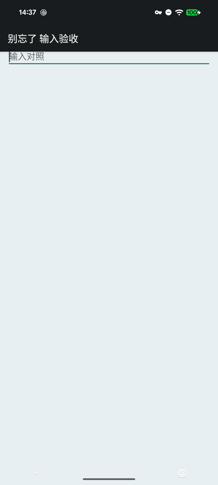
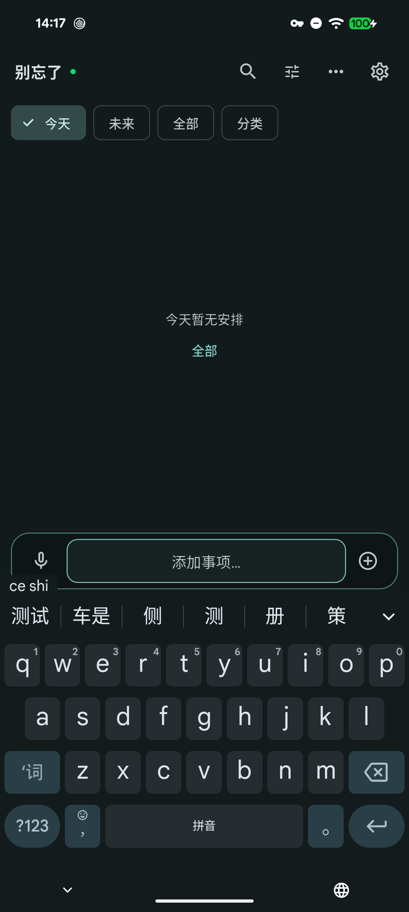

# Android +74：真实输入法与原生对照

2026-11-12，阶段47。本轮补验当前应用代码的输入工作流，发行版本仍为[v1.8.5+74](https://github.com/yarnway/dontforget/releases/tag/v1.8.5)。[机器记录](benchmarks/android-ime-74-2026-11-12.json)区分通过项、初始故障与恢复后的结果。

## 身份与源码

- Pixel 8 Pro，Android17／API37；微信输入法3.5.2、Gboard18.5.6。操作通过ADB触摸屏点按／滑动完成，没有注入字母键事件或直接填充编辑器文字。
- 独立debug身份 `com.yarnway.dontforget.acceptance.ime20261112`，普通入口 `lib/main.dart`，本机Flutter3.47.2；源码9f0fb48的lib树为`0f27251030aceca4c34472cb3460b2e986c8ade4`，与已发布源码26c90e0相同。普通入口与加入原生对照Activity的两份私有APK均验证身份／版本／同debug签名。
- 原生对照只加入独立构建目录，使用[EditText夹具](../test/support/android_ime/ImeControlActivity.java)，实际EditorInfo读回`inputType=0x28001`、`imeOptions=0x02000004`。原生控件与Flutter输入框分别观察。
- 以上不是固定SDK3.44.9公开APK的同矩阵验收。未改运行时、版本或依赖；无新公开安装包／Windows安装动作。+74原有自动化、安装与运行中升级证据见[发行记录](Release_1.8.5_74_2026-11-12.md)，没有记作本轮重跑。

## 输入与持久化结果

| 场景 | 真实操作与读回 | 结果 |
| --- | --- | --- |
| Gboard中文 | 点按屏幕`ceshi`，显示“测试”候选，选词进入草稿；候选期间事项数0 | 通过 |
| 草稿与模式 | 收起／重新点开、文字→语音→文字，已提交中文保持 | 通过；仅切换模式，未录音 |
| 回车发送模式 | 选“仅备忘”，点软件Send仅新增一条；空草稿再次Send不重复；新PID冷重开SQLite全字段一致 | 通过 |
| Gboard英文 | 系统选择器选English(UK)，点按`hello`及空格；切到微信输入法再回Gboard，已提交草稿保持；Send及冷重开一致 | 通过；微信键盘此时仍空白 |
| 仅发送按钮模式 | 通过设置页“保存并返回”提交偏好；软件Enter产生换行，事项数不增加；`alpha\nbeta`草稿持久化并在新PID恢复，点击App发送新增一次 | 通过 |
| 恢复后的微信输入法 | 纯触摸拼音与候选、收起重开、文字／语音切换；组合态点App发送不新增事项且文字保持，选词后明确发送并冷重开 | 通过；前提是下述服务现场恢复 |

最终4条合成备忘／0媒体／1设置，均无提醒时间。第二次中文备忘与原中文备忘自动建立预期双向关联，逐字段确认仅对应关联字段改变；其他既有字段保持。应用未配置AI或转写服务，本轮不作语音识别或系统通知送达结论。

## 微信输入法空白：对照与边界

首次普通点开、收起重开、文字／语音模式切换均出现输入框有焦点、系统报告IME已显示而无键盘按键。相同参数的原生EditText也出现空白；临时开启“有实体键盘时显示屏幕键盘”未恢复，随后还原。

选到其他输入法后，仅重启空闲微信输入法进程并重新绑定，原生控件与Flutter中均恢复完整QWERTY，再完成上表中文测试。未清除输入法数据、词库或登录信息。微信输入法按键画在自定义View中，没有单个Q键语义；只查语义节点会误判，故结合实际截图和键盘容器边界判断。

这说明本次初始空白也出现在原生输入控件，不能据此断言所有输入问题都来自输入法；重新绑定只是现场恢复，根因及长期兼容性未闭合。

 

## 重复验收

1. 使用与目标源码相同的lib，在独立Android构建副本设置新的`.acceptance.` applicationId及测试名称；普通入口仍用`lib/main.dart`，不配置AI／转写凭据。
2. 先记录原输入法、subtype及硬件键盘显示设置，核对测试身份未预先存在；以普通入口完成屏幕按键、候选、Send、草稿冷重开和SQLite读回。
3. 仅在该副本中加入上述Java夹具和同名导出Activity，保持应用lib不变；安装覆盖自有测试身份。分别启动MainActivity／ImeControlActivity，确认实际EditorInfo，再对照键盘截图与容器边界。不要只凭IME已显示或单键语义缺失判断可见性。
4. 清理独立身份和自有临时文件，恢复原输入法设置及Gboard原语言，保留不含个人数据的计数／摘要；测试身份内的合成事项不应混入正式／QA数据。

## 清理与剩余

已恢复原默认微信输入法、subtype -1、有硬件键盘时显示设置0；Gboard恢复原简体中文拼音。临时应用已卸载，4条合成记录随独立身份移除；自有ADB XML和私有构建目录中的对照Activity已移除。测试写入仅发生于独立身份；正式／QA未执行覆盖安装、清除或测试编辑，结束时回到普通正式App。

仍需：微信输入法空白根因及无需重启的稳定恢复；固定SDK普通包、其他输入法／机型、真实用户组合输入、休眠／重启通知与录音中断、Windows GUI。阶段46 USB长期／跨主机、48附件恢复／故障／保留／压缩、49批量改期／动态预测／档案／分享同步、50 Apple／正式签名／商店仍按台账推进。
