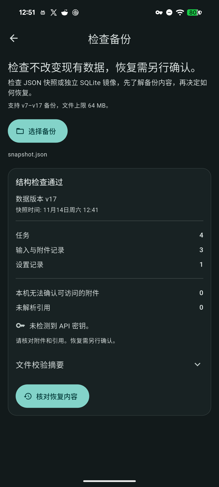
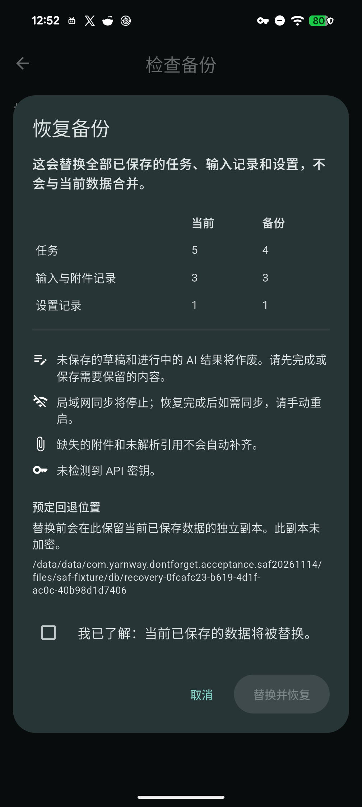

# Android 系统文件选择器与附件恢复

阶段48，本轮以独立身份和合成数据补齐本地 SAF 路径。正式版仍为v1.8.9+78；本轮没有安装或发布普通应用新版本。

## 运行时代码与范围

设备验收使用本机Flutter3.47.2的独立debug应用，运行 `MyApp`、实际备份页面、原生保存／打开选择器、预检、确认弹窗和恢复协调器。运行时lib树为 `ecd624edf439ce06c60c6fa80ef63d60f35a1c23`，与已发布v1.8.9源码0e14c78一致；不是固定CI普通发行APK的触控验收。

数据库为独立原生SQLite，通知使用替身，外部HTTP客户端禁用。表单文字与密码由控制器注入，不记软件IME、真人语音、云端识别、系统通知或真实凭据验收。只使用Android本地Downloads文档提供器；第三方及云端提供器未验。

## 已完成

| 路径 | 实际核对 |
| --- | --- |
| 中文普通备份／英文加密备份 | 原生保存对话框，实际外部文件SHA与流式导出源一致；最近导出记录名称及本地content URI |
| 取消保存／取消打开 | 全业务字段、媒体引用和原件保持；取消导出后缓存释放 |
| 普通备份本机恢复 | 原生打开选择器输入SHA等于导出源；4事项／3媒体／1设置，预检缺失与未解析引用均0 |
| 核对与明确确认 | 未勾选时禁用恢复；取消核对保持数据库且不创建恢复操作目录；勾选后实际执行恢复，旧数据与运行时令牌作废 |
| 普通恢复冷重开 | 新PID，事项／设置全字段、重新定位的3份附件及3份源原件摘要保持 |
| Windows后端互通 | 两种导出实际恢复至独立FFI数据库、关闭重开、保留设备偏好，追加第4份合成附件再导出；显式2项通过，未使用桌面GUI |
| 加密Windows返回→Android SAF | 原生打开返回文件，输入SHA等于Windows输出；错误密码不改数据，正确密码预检及确认恢复至5事项／4媒体／1设置 |
| 加密返回冷重开 | 新PID，全部字段及4份附件摘要保持，路径落入Android自有媒体目录，没有保留Windows路径；初始3份原件保持 |

初始录音WAV、PNG和UTF-8文本合计70000字节，Windows新增文本82字节。未声称已完成真机大容量、原始显示名保留或真实麦克风采集。备份密码没有写入业务表。

[机器记录](benchmarks/android-saf-attachments-2026-11-14.json)分别保留手机结果和Windows后端报告。入口及复现步骤见[显式验收说明](../scripts/acceptance/README.md)。

## 失败修正与清理

首轮夹具只接受externalstorage authority，误拒同属本地的Downloads authority：原生已写文件，夹具随后报错。首轮APK／文件及失败记录保全，修正夹具后重跑，普通应用运行时代码未因该问题修改。驱动另修正了保存返回应用、加密等待和已选目录的状态检查；选择器停留期间桥接读回超时，改为返回应用后读回，不将这些驱动失败记成产品失败。

结束后将3份外部合成文件保全至本机并核对SHA，再只删除本轮文件及空目录；临时身份卸载，自有ADB转发和XML移除，原前台和输入法设置恢复。普通应用安装路径／版本保持，未对其安装、清库、录入或恢复；本轮没有重新读取普通应用业务表或真实凭据，不能挪用为新的普通升级验收。

## 提示文案修正（源码迭代）

实机流程发现，通用预检和恢复确认沿用“备份不包含附件”的旧说明，与完整备份含附件的行为矛盾。中、英、日文已改为简洁的附件／引用核对和缺失提示，保留独立确认要求。

该修改在上述设备矩阵之后进行。本机相关4文件41项通过、分析0；源码`1ee54c4425615c3cc3df4ae4dd4bb150228f977c`／lib树`508c32b74fc64d9a6c6c4dd2d122499a0dcc42a3`的另一轮独立Pixel实际读回中文预检及确认新文案，原“备份不含附件”文字均不存在。原生保存／打开文件、检查不改库、勾选确认后实际恢复4／3／1、附件重新定位与新PID全字段／摘要读回完成，旧数据和运行时令牌作废；临时身份／自有文件／转发清理，输入法设置保持。[本次源码设备证据](benchmarks/android-saf-copy-native-2026-11-14.json)。仅此轮普通路径／中文原生提示；加密跨端完整矩阵保持前述已发布运行时归属，中英日布局由组件回归覆盖，不冒记英日原生触控通过。

最终[固定SDK CI](https://github.com/yarnway/dontforget/actions/runs/43557412492)七项成功：Analyze and test：Flutter2571通过／2跳过，Python170运行／4跳过；Windows analyze and test：Flutter2553通过／20跳过，Python170运行／6跳过。5份候选artifact来源／摘要元数据核对，未新下载普通候选做完整字节或覆盖安装验收。[CI证据](benchmarks/github-ci-saf-2026-11-14.json)。没有改依赖、schema或版本号，尚未进入公开v1.8.9安装包；本轮未发布普通新版本，Windows运行中及双Android新版保全覆盖留待下一候选。

 

## 剩余

Windows文件选择器／桌面GUI、Linux实机、手机大容量、磁盘满／断电、真实凭据锁定及其他文档提供器继续验收。备份保留、外部引用登记与原声压缩仍待实现；46 USB长期／休眠／跨主机，47 真人语音／IME／通知／无障碍与Windows GUI，49 词条迁移／个性化／分享／同步冲突，50 后续候选升级发布及Apple／签名／商店分发保持在[阶段台账](Next_Steps_2026-11-02.md)。
