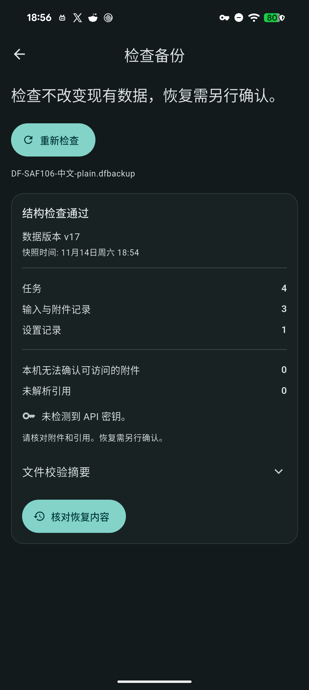

# 完整备份导入：自动预检与原文件名

阶段48源码迭代，尚未进入普通发行包；正式版保持v1.8.9+78，无版本号、依赖或数据库迁移。

完整备份经系统选择、解密和文件验证后，进入预检页自动开始只读检查，显示用户选择的原文件名。移除重复的“选择备份”操作和与此入口无关的数据库快照说明；检查失败／取消后可“重新检查”同一个已验证的私有快照。

自动化只到预检结果，不准备或执行数据替换；恢复仍须点击“核对恢复内容”、勾选并明确确认。独立的数据库备份检查入口仍手动选择。展示名称去除路径，拒绝控制字符及过长名称；缺少有效名称显示“已选备份”，不显示内部snapshot.json或私有路径。展示名不参与文件打开、摘要或恢复计划绑定。

本机原生Flutter3.47.2相关4文件44项通过，分析0。新增覆盖自动检查一次、忙时阻止重复、重试绑定相同源、错误不开放恢复、路径名／非法名称及销毁后取消迟到结果。首轮测试在异步名称更新尚未渲染时断言失败，增加对应帧等待后完整复验；不把该驱动时序误差记作产品缺陷。

独立Pixel、本机SDK3.47.2、源码`7f7d1c7cd42449650234dc3feebbce41022982f9`已完成实际SAF保存／打开：返回应用后直接出现预检结果，原中文文件名可见、snapshot.json与64MB快照说明不显示，无二次“选择”点击。预检全表／原件保持，明确勾选后实际恢复4事项／3附件／1设置，附件摘要／路径重建、旧代次作废及新PID全字段读回通过；临时身份／自有文件／转发和XML清理，输入法设置恢复。表单为控制器注入，通知替身、HTTP客户端禁用；仅中文普通小样本，未重做加密／英日原生矩阵。[实机记录](benchmarks/backup-auto-preview-native-2026-11-14.json)。

最终[固定SDK CI](https://github.com/yarnway/dontforget/actions/runs/43587785394)七项成功：Analyze and test：Flutter2574通过／2跳过，Python170运行／4跳过；Windows analyze and test：Flutter2556通过／20跳过，Python170运行／6跳过。5份候选artifact来源／摘要元数据核对，未下载普通候选做完整字节或升级验收。[CI证据](benchmarks/github-ci-backup-auto-preview-2026-11-14.json)。

未发布新版本或操作普通Windows／双Android安装。下一候选仍需Windows运行中覆盖、双Android保全升级、发行包及发布后读回。阶段46 USB长期／跨主机、47 真人语音／IME／通知／GUI、48 桌面选择器／容量／真实故障／备份保留及原声压缩、49 词条迁移／个性化／图片分享／LAN冲突、50 Apple／签名／商店继续。

Windows另作只读空间核查：当前应用支持目录61060字节、旧本地数据库目录24859字节；开发覆盖升级保全目录2394419558字节，单独归类。仅枚举／统计指定目录，不含安装文件和其他媒体根，不读取文件内容或凭据，也不改权限／删文件；这些保全副本不能作为普通应用缓存直接清除。[统计](benchmarks/windows-storage-readonly-2026-11-14.json)。

Windows界面另重试computer-use 26.1111.21308：`node_repl`在窗口发现前仍返回工作目录URI错误，未执行UI操作，未使用PowerShell UIA替代。桌面GUI不记通过。[记录](benchmarks/windows-gui-retry-2026-11-14.json)。

