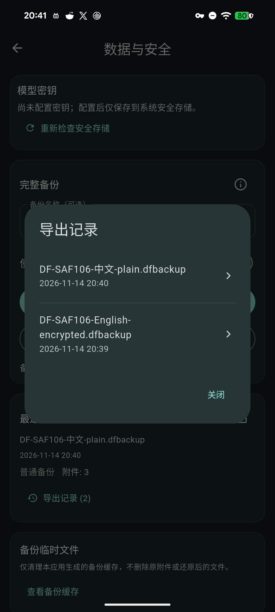

# 备份导出记录

已随v1.8.10+79发布，普通新包与升级范围见[本轮发行](Release_1.8.10_79_2026-11-15.md)。以下保留原源码迭代的版本、测试和合成设备归属。

原阶段48源码迭代时，正式版为v1.8.9+78；该轮无版本号、依赖或数据库迁移。

保留最近20次成功导出的名称、时间、保存位置、加密状态及附件计数。主页面继续展示最近一次导出；有多条记录时按需打开“导出记录”，列表只显示名称和时间，点选后查看保存位置。中英日、明暗主题、窄屏与大字体共用同一交互。

沿用`lastPortableBackup`存储项，原有单条记录无需迁移写入。新记录以有界扁平列表保留旧记录，去重并过滤无效元数据；不保存密码、凭据或任意附加字段。未知未来格式保留原值，导出文件成功但记录未保存时准确提示。写入前读取当前持久值，并以比较更新避免覆盖另一写入者；其他草稿与设置字段保持。

记录只描述导出位置。查看记录不打开、修改或删除文件；恢复仍通过系统选择器重新选取和验证。20条上限仅作用于位置记录，未实施外部文件保留或清理。系统文档提供器权限、文件移动／删除、人工登记外部备份及自动保留策略继续待验或实现。

本机原生Flutter3.47.2相关5文件55项通过，分析0。覆盖旧单条记录兼容、20条上限与去重、无效／未来格式、只读及重开、取消导出与SQL拒写；中英日明暗、大字体与320／768宽度的20条列表滚动及详情读回通过。首次大字末行点击未等待滚动布局更新，补等待和可点击断言后整组复验；失败日志保留，不记产品布局缺陷。

独立Pixel、本机SDK3.47.2、源码`9f07c05b8c57a09c682fbb6b0f53259d97bce41e`：实际SAF加密英文名／普通中文名导出，外部文件摘要与源文件相同，两条记录按序保留，列表默认隐藏位置；点选旧记录读回原保存URI，查看全程不写库。取消第三次保存后记录及两份文件保持，新PID全字段／附件／原件和历史列表读回一致；4事项／3附件／1设置及其他草稿保持。临时身份、自有外部文件、转发与XML清理，输入法设置保持，普通应用安装未操作。表单为控制器注入、通知替身、HTTP客户端禁用；仅中文界面，英日原生另验。首轮节点转义换行及系统选择器返回层级／返回后界面范围守卫的驱动失败已留存，核对当前界面后续验完成，无产品源码修改。[实机记录](benchmarks/backup-export-history-native-2026-11-14.json)。

最终[固定SDK CI](https://github.com/yarnway/dontforget/actions/runs/43595872072)七项成功：Windows analyze and test：Flutter2570通过／20跳过，Python170运行／6跳过；Analyze and test：Flutter2588通过／2跳过，Python170运行／4跳过。5份候选artifact来源及摘要元数据核对，未下载普通候选做完整字节或升级验收。[CI记录](benchmarks/github-ci-backup-export-history-2026-11-14.json)。原源码轮次未执行普通安装包覆盖或发布；后续v1.8.10的普通包升级与发行范围见上方分层记录。

