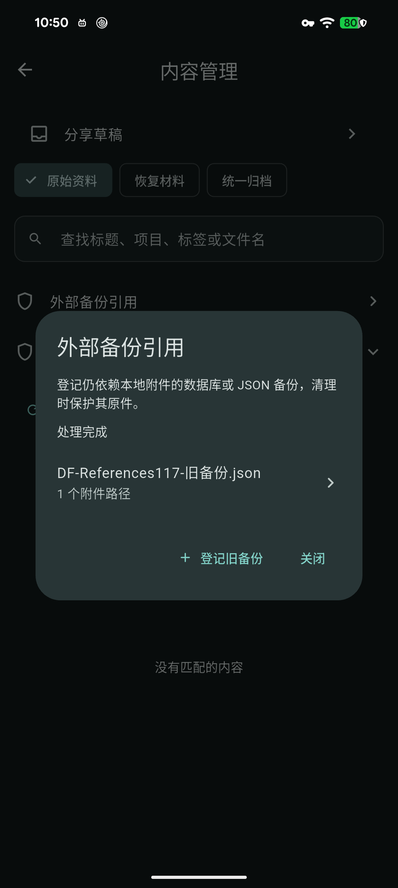

# 阶段48：外部备份引用登记

源码实现：内容管理增加按需打开的“外部备份引用”。用户选择仍依赖本地原件的数据库或JSON备份，经既有只读预检后明确确认登记；列表默认只显示原文件名和附件路径数量，点选查看路径，移除登记另行确认。任务详情、语音手势和编辑发送流程保持原实现。

登记为附件引用快照，只保存文件摘要、原名称、登记时间与去重路径，不保存备份正文、设置、凭据、选择器缓存路径或附件副本。外部源移动／不可访问不解除保护；查看登记不访问外部源。登记最多20份、累计4000条路径／256KiB元数据，超限拒绝整个新增，不自动淘汰旧保护；相同文件摘要重复登记幂等。

沿用业务数据库的独立草稿键，无schema／依赖／版本号变化。写入前读取持久值，确认后比较更新，防止覆盖并发变更；数据库及恢复运行代次失效后不写入。移除仅解除该登记，不删除源备份或原件，其他任务／草稿／自动备份保护继续生效。

清理器在实际删除事务内重新核对登记，已预览的删除计划遇新增保护即拒绝；中断清理重试遇登记引用时还原已暂存原件。登记未知版本、损坏或超限时禁止物理清理，不猜测为无引用。

## 分层验证

- 源码：本轮实现及独立合成验收入口，公开版本仍v1.8.10+79；本轮没有普通应用覆盖升级或新发行。
- 本机自动化：Windows原生Flutter3.47.2，相关5文件140通过／3跳过，全库分析0。包括JSON／SQLite预检输出、20份上限／去重／容量、损坏与未来格式、并发写入、SQL拒写、失效代次／销毁晚回调、重开／中断清理、三语明暗320宽大字20条滚动，以及原内容管理375／768／1440宽布局。3跳过为本机符号链接权限及macOS专属条件。首轮界面驱动缺少本地化等待、等待持续动画及整段文字精确匹配错误已留证并修正；一次并行重跑遇测试DLL占用，之后顺序重跑通过。
- 独立Pixel8Pro／Android17、本机SDK3.47.2：最终源码72a7080（lib树0b85d48）普通应用入口，真实SQLite初始1事项／1文件记录／1设置；系统选择器取消、JSON原名称／摘要与预检后取消、明确登记均验。登记使原件可清理字节从非零变为0，移走已保全外部副本及新PID冷重开后仍保护；只读详情、移除前取消、明确移除后原件保持且再次可选择清理。事项／媒体全字段、其他设置／草稿、源与原件摘要保持，未实际清理原件。中文原生触控，无表单注入；通知替身、外部HTTP禁用，不替代真人语音／真实凭据／通知或英日原生。临时身份、自有外部文件／转发／XML已清理，原前台及输入法设置恢复，普通正式／QA安装未操作。
- 首轮合成入口缺少JSON必需timestamp字段，被预检拒绝；登记／原件保持，证据保全后清理独立身份，修正夹具并重建重验。设置入口名称、选择器返回层级及ADB推送文件未索引造成的驱动停顿分别留证，按实际界面续验，无产品lib修正。最终独立APK与源码文件摘要已核对；不是普通发行包。
- 最终源码72a7080的固定Flutter3.44.9 [CI](https://github.com/yarnway/dontforget/actions/runs/43669528199)七项成功：Linux Flutter2609通过／2跳过、Python170运行／4跳过；Windows Flutter2591通过／20跳过、Python170运行／6跳过。五份候选artifact来源／摘要元数据核对；未新下载普通候选做完整字节或覆盖安装验收，Apple只记候选构建。[CI证据](benchmarks/github-ci-external-backup-references-2026-11-15.json)。初始79e07b9轮次由修正夹具的最终提交替代，不作为最终验收来源。
- 源码／本机测试与[独立Pixel证据](benchmarks/external-backup-references-native-2026-11-15.json)各自留存，[源码索引](benchmarks/external-backup-references-source-2026-11-15.json)。本轮未重做普通包覆盖升级、新装或发布。

## 范围与剩余

适用于既有预检支持的v7至v17独立SQLite／JSON备份（最大64MiB、单表最多100000行），登记另受上述引用元数据上限限制。包含附件的完整便携备份已携带附件，不在此入口重复登记；其导入／恢复仍走原备份页面。

不扫描任意外部目录、不自动删除历史备份、不把选择器临时副本当永久权限，也不保证登记备份可完整恢复。外部文件保留策略、目录接管／空间统计、桌面系统选择器、更多文档提供器与手机大容量、真实故障／凭据锁定、原声压缩继续；阶段46／47原生门槛、49词条迁移／个性化／图片分享／LAN冲突、50下一新版保全升级及Apple／正式签名／商店仍待执行。
