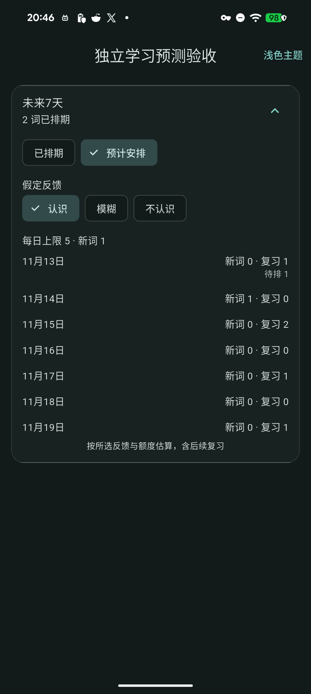
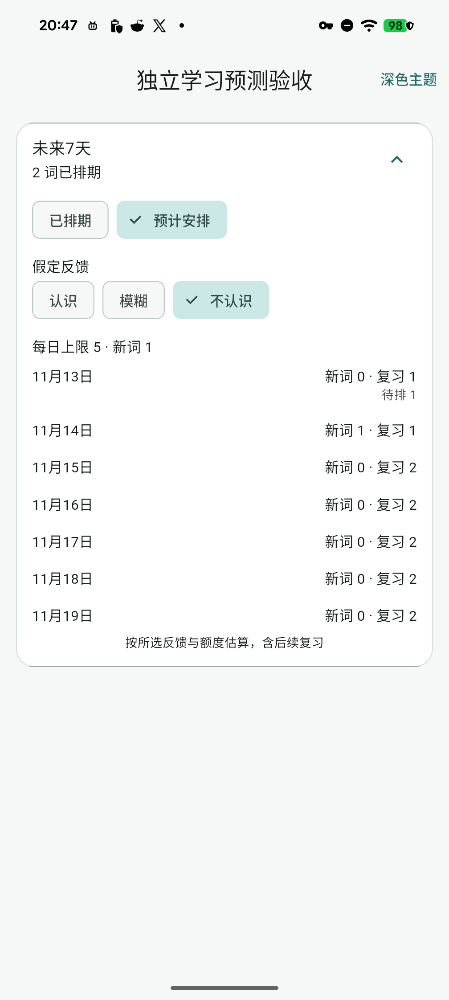

# 七天学习负担情境预测

阶段49源码迭代，基于已发布v1.8.8+77；schema17与依赖保持，尚未进入公开安装包。源码、自动化、私有合成实机和普通安装包分别记录。

## 范围

学习计划和学习管理共用的“未来7天”仍默认收起、默认展示已排期词条。展开后可切换“预计安排”，选择“认识／模糊／不认识”作为未来反馈情境，查看七天的新词、复习和待排数量。只有一条简短说明标明估算含后续复习；不自动更改真实排期或提交反馈。

预测使用当前真实学习队列和grade规则，每天先处理复习，再按新词额度补充。今天扣除所有历史中的已学／首次学习额度；共享词条按统一身份去重，采用最新反馈及手动改期合并规则。暂停、完成、归档和回收站不入队；共享反馈仍在影子批次中同步，保持后续批次日期与真实反馈操作一致。当天未安排的词条继续待排，未来天数使用日历日期而非固定24小时。

所有变化只存在于临时影子行；原始事项、进度、设置、附件及原件不写入，也不调用通知。结果是所选统一反馈情境下的安排，不是对个人未来记忆率的统计预测。损坏记录、非法间隔或未来复习历史显示预测不可用，已排期视图仍可切换。未变数据／日期／反馈／额度／间隔复用结果，前台恢复及跨日重算；无高频空闲轮询。

## 本机自动化

Windows原生SDK3.47.2相关97项通过、分析0，包含学习队列、计划管理／改期和档案回归。新增模型测试逐日对照真实SQLite七天gradeWord提交，分别覆盖三种反馈情境；同时覆盖后续间隔、自定义间隔、零新词额度、今日已学、共享／手动改期、隐藏批次、跨月及1000词容量。输入快照不变、结果不可变；错误数据不会显示成空预测。

页面覆盖三语、320／1280宽度、两倍字号、明暗主题；切换模式／情境后全SQL快照和通知记录保持。真实反馈及暂停、额度和间隔变化会使可见预测重算。初轮两个测试循环的花括号分析提示已修正，复验无告警；初轮独立Pixel验证了三种情境与只读／冷重开；随后把待排提示移至数量下方，统一各行统计右边缘，源码及相关97项再次复验。日志分别保留在本地build/stage98、build/stage99。

 

## 独立实机与后续验收

最终源码38587ed的独立Pixel身份6事项／1原件／1设置：三种反馈的七天新词／复习／待排读回一致，统计右边缘统一；明暗切换、已排期返回与收起、新PID重开完成，SQLite全业务字段、设置、媒体、原件及通知记录保持，输入法配置未变，临时身份卸载。[实机证据](benchmarks/learning-forecast-native-2026-11-13.json)。最终[固定SDK CI](https://github.com/yarnway/dontforget/actions/runs/43427823053)七项成功：Analyze and test：Flutter2561通过／2跳过，Python170运行／4跳过；Windows analyze and test：Flutter2543通过／20跳过，Python170运行／6跳过。5份候选artifact来源与摘要元数据核对；本轮未下载普通候选包做完整字节或覆盖升级验收。[CI证据](benchmarks/learning-forecast-ci-2026-11-13.json)。初始c9cf213的CI因布局收口被取消，未挪用为最终通过。未为本轮新建公开版本或覆盖普通Windows／Android应用；既有v1.8.8的升级与发布证据保持原归属。下一发行仍需新备份、Windows运行中覆盖、双Android及公开附件门禁。

剩余：46 USB长期／跨主机；47 真人输入、录音与时延／中断、通知、无障碍和Windows GUI；48 带附件GUI恢复、真实故障、保留与压缩；49 受保护词条重置／迁移、个性化预测、更多排程、图片分享／LAN冲突；50 下一版升级发布及Apple／正式签名／商店。
