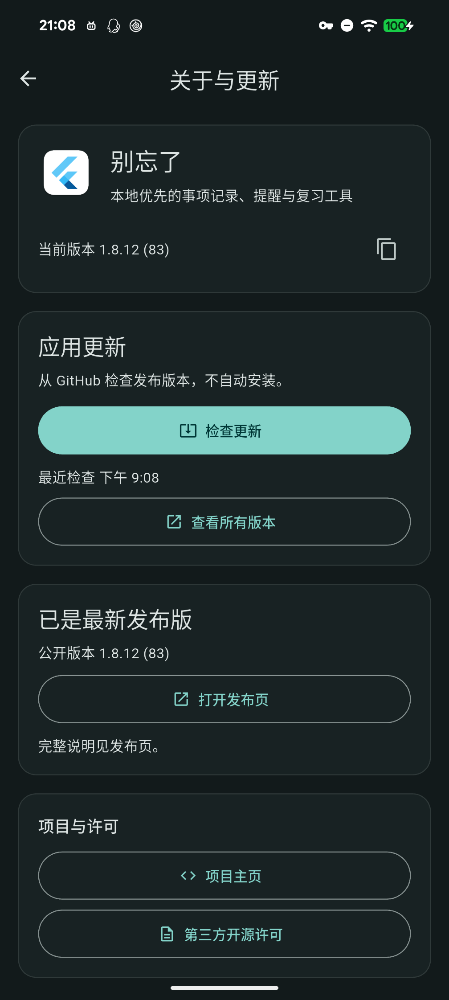

# v1.8.12／build83：界面、阅读与产品文案发行

[v1.8.12](https://github.com/yarnway/dontforget/releases/tag/v1.8.12)已发布并设为latest，源码`ffdfa5acf88afe07c9a5501f1a46e5f0804a57c8`、build83、schema17。Windows／Linux／Android／iOS七份安装包与20附件已独立读回；Windows和双Android已保全升级83，iPhone83尚未安装或真机验收。build82保留[未发布历史候选及原证据](Release_1.8.12_82_2026-11-16.md)，不将其结果换记83。

## 源码与自动化

本版合入设置六入口的用途说明、统一层级与大字分组、关于页复制与更新操作整理，以及60组键、中英日168条简短专业文案。四份表2295条逐项比较，其余2127条与键／占位符保持。统一浮层`InlineFeedback`普通成功至少4秒，较长指定时长保留；其他至少8秒，操作提示／无障碍导航模式持续保留。这不表示全部旧SnackBar时序被重写。[文案约定](Product_Copy_Guidelines.md)／[实现与范围](Product_Copy_2026-11-16.md)。

详情补充和原始记录使用较大的正文及1.6倍行距，桌面阅读列收至800、底部修改同宽；保留系统缩放、文本选择和默认只读。更新结果／错误建立独立语义容器，避免状态标题与“更新说明”混为一个节点。[本轮三步审查与前后对照](UX_Reader_Accessibility_2026-11-16.md)。f3fdbdb为源码审查来源，最终ffdfa5a的lib树相同，新增83构建号后才形成本版包；不把原源码-only状态写成当时已安装。

本机固定Flutter3.44.9／Dart3.12.2相关5文件76通过／0跳过，分析0问题；此前文案125及修正定位后54项保留原归属。首轮旧文案定位失败、过早独立iOS任务的CI门禁拒绝、阅读夹具定位／布局等待与基线导入失败均保留。新增语义契约在旧1c页面按预期行为失败、新源码通过；未删除断言或增加跳过。

[最终CI43862178029](https://github.com/yarnway/dontforget/actions/runs/43862178029)七项成功：Linux Flutter2639通过／2跳过、Python180运行／4跳过；Windows Flutter2621通过／20跳过、Python180运行／6跳过。Windows隔离安装／启动、Linux原生启动／清理与平台打包门禁通过；macOS不在本轮公开发行平台。[CI回执](benchmarks/github-ci-release-83-2026-11-16.json)。

## 安装包与Windows真机

四份来源ZIP完整SHA256与CRC、18来源文件、Android两个APK及AAB固定证书／实际版本／ABI、Windows原生资源、Linux版本与报告、iOS主／扩展实际身份／版本及未签名且无描述文件均核对。[发布前回执](benchmarks/release-83-prepublication-2026-11-16.json)。公开iOS为普通身份，独立手机验收包另列。

Windows先核对当前82与1c9aa15来源CI字节一致，重新取最新受保护备份，再在应用运行时由安装器正常关闭后82→83覆盖。安装器0退出、不强关；38payload、5事项／0媒体／1设置全字段、实际DPAPI凭据和普通重开保持，资源版本1.8.12／83。发行后摘要仍与实际安装的同一CI包一致，无新二进制需要重复安装。[本机回执](benchmarks/windows-local-upgrade-83-2026-11-16.json)。电脑界面工具cwd URI初始化错误仍保留，未把CLI／资源／进程读回记为Windows GUI验收。

## Android真机

初次只读探测未见Pixel；后续再次探测原授权Pixel8Pro已在线、解锁、两应用82且无录音。首次导航守卫因前台为另一独立QA身份而安全停止，未发送输入；重新观察QA首页后进入正式首页，再核对两个普通首页无待处理输入。

分别核对原82 APK、用82同版本导出工具取最新备份，恢复原普通82 APK后才升级83；没有用83工具生成“升级前”基线。正式CI ARM64 82→83，通用／ARM64同版互换后留ARM64，2事项／0媒体／1设置保持；独立QA固定SDK普通debug 82→83，56事项／9媒体／1设置、9份媒体与1项实际安全存储保持。三表所有字段、实际安全存储、媒体摘要、冷重开与最终普通APK字节分别核对。两份历史恢复指针保持，没有卸载、清数据或覆盖指针。[真机回执](benchmarks/android-upgrade-build83-2026-11-16.json)。

实际设置→关于显示1.8.12（83）、复制标签可访问；首次手动更新超时，错误正常显示并返回首页。发布后再次实际点击，显示“已是最新发布版”和公开1.8.12（83），状态标题在原生界面树可见，返回普通首页。没有读写剪贴板、保存设置或新增业务记录；未听取TalkBack实际播报，不称完整读屏合规。[原生分项回执](benchmarks/about-updates-native83-2026-11-16.json)。

## iPhone包与未完成范围

[独立身份任务43868257576](https://github.com/yarnway/dontforget/actions/runs/43868257576)首轮排队15分钟，无runner、无任何执行步骤，GitHub注释明确为macOS arm64容量不足。保存失败后，仅重跑失败任务一次；第二次成功，来源仍ffdfa5a。完整核对83 ZIP／IPA摘要与CRC、主／扩展`acceptance.iphone15-20261115`身份、版本和未签名；入口文件`DontForget_iOS_unsigned_v1.8.12+83.ipa`已准备。[包与设备分层回执](benchmarks/ios-build83-source-and-runtime-2026-11-16.json)。

手机最近独立读回仍1.8.11／81，本轮随后USB无iPhone；未安装83、未读Keychain、未自动处理Apple认证。此前81的保全快照保留历史归属，下次实际安装前必须重新取最新备份。用户要求免人工升级，但当前未找到可用静默签名安装路径，电脑界面工具初始化限制未解除。

本次依既有四平台发布策略发行已核对的未签名IPA，在Release正文明确iPhone83真机未完成；不把发行成功或独立包构建成功当手机安装成功。免费账号AltStore通常7天续期，不属于App Store／TestFlight分发。公开普通身份和独立验收身份分别保留，不能直接以普通包合并独立应用数据。[安装说明](iOS_Sideload_Windows.md)。

## 发布与公开更新

[发布43871693626](https://github.com/yarnway/dontforget/actions/runs/43871693626)prepare／publish均成功。随后仅为本次新Release正文补充明确的真机范围，保存修改前后摘要并读回；没有改包或标签。独立核对tag精确指向ffdfa5a、正文、20附件集合／大小／摘要、latest与公开来源／总摘要。旧v1.8.11正文和20附件ID／摘要保持。[发行回执](benchmarks/github-release-v1.8.12-2026-11-16.json)。

沿用已验证的Windows CRLF／不区分大小写排序与Linux LF／区分大小写排序的显式归一化：18来源文件逐字节一致，来源JSON仅按文件名排序与换行重建后精确比较，用实际公开LF来源JSON重算全部19项摘要。保留原始本地准备文件；大公开包使用GitHub摘要结合已完整校验的来源ZIP核对，没有二次下载所有公开大附件。

应用实际无认证更新服务复查成功，识别1.8.12／83为`current`，六个下载选择且含iOS；Pixel真实点击也返回current。桌面服务探针不冒记为Windows GUI或iPhone触屏。[服务回执](benchmarks/update-service-postrelease-83-2026-11-16.json)。

## 剩余阶段

- 46：USB自然空闲、休眠／唤醒、跨端口和主机对照，当前接入成功不等于长期问题解决。
- 47：首页密度与统一品牌图标，Windows GUI／Toast／托盘／麦克风，iPhone83安装与通知／录音／灵动岛／输入法／读屏；Pixel完整通知／输入法／录音与TalkBack。
- 48：容量、真实故障、凭据锁定、外部文件保留、目录接管、空间与原声管理。
- 49：受保护词条迁移、个性化、图片分享与LAN编辑／删除／附件冲突。
- 50：iPhone实际保全覆盖、免费签名续期、后续每版最新保全升级、macOS真机／公证及Windows签名商店。

完整状态见[阶段台账](Next_Steps_2026-11-02.md)。本版发行已完成，上述原生和长期矩阵仍独立待验。
