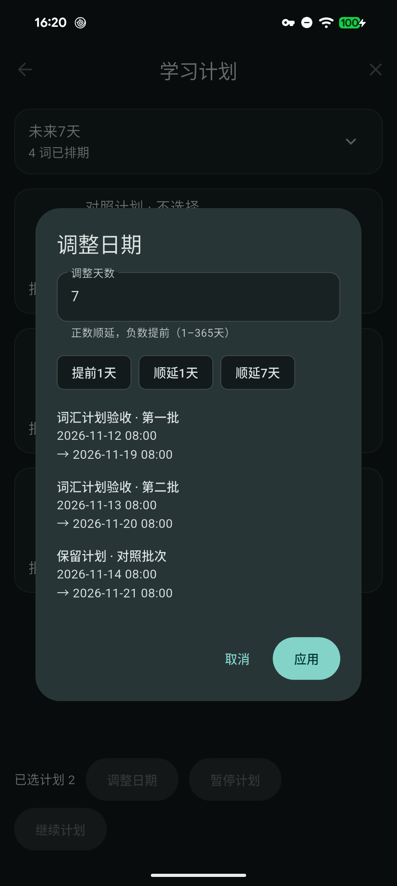

# 学习计划：批量调整日期

本轮为未发布源码候选，正式版仍为 [v1.8.5／build74](https://github.com/yarnway/dontforget/releases/tag/v1.8.5)。未改变版本号、schema17或依赖，未替换发行附件。[自动化与独立实机证据](benchmarks/study-date-source-and-native-2026-11-12.json)。

## 使用与范围

在学习计划菜单或多选操作栏选择“调整日期”，预览每个待学习批次的前后日期，再应用。支持提前／顺延1～365天及1天、7天快捷操作；最多20计划／50批次。完成、归档及回收站批次不改期；重复批次暂不支持。窄屏与大字下自动换行，预览可滚动，确认操作保持可见。

改期保留掌握度、学习次数、首次／最近复习时间、暂停状态、附件及原声。已学习词条的全局到期日只调整一次；若未选计划也在使用相同词条，要求一并选择，避免暗改其他计划。七天概览和实际复习队列使用调整后的日期。提前到过去的批次取消旧通知，不立即重放过期提醒。

## 数据保护

预览冻结完整计划快照及相关共享进度。提交在同一SQLite事务重新读取并验证；成员新增、编辑、移组、删除、学习记录变化或新增共享计划均拒绝陈旧操作。任一写入失败整体回滚，原生通知只在提交后协调，失败提供修复入口。

词条JSON增加可选 `rescheduled` 时间戳，不更改学习级别、次数或最近复习时间。最新复习优先，同次复习按最近改期取值，防止完成／归档历史覆盖新日期；删除旧批次归档时同样保留较新进度。备份检查及恢复准备保留此字段。按本地日历调整日期，保留钟点及UTC表示；本机验证跨月、闰日和跨年，真实DST转换宿主尚未验收。

## 分层验证

- 源码：共享Flutter实现；运行时lib树 `0873723c29ee795ed3c8a18f8848525a968bda15`。正常数据无需网络、AI或新依赖。异常进度安全拒绝预览；最终源码`ca1893f59817ff4159c7fed6adaa8321dbb711a0`另补改期后编码长度上限检查，防止接近上限的历史在写入后无法读回，独立实机随最终源码重建复验。
- 本机自动化：Windows SDK3.47.2，首批相关117项通过；最终日期／页面39项通过（领域20、页面19，批次存在重叠，不相加），静态分析0。覆盖事务回滚、共享进度、历史归档、恢复代次、通知失败、备份／附件、三语375／1280宽度和200%文字，以及50批次、小屏和模拟键盘组合。
- 独立实机：Pixel 8 Pro，独立debug身份及4条合成数据；实际触控选择2计划／3批次，取消预览全字段不变，顺延7天再提前1天，未选对照保持；已学词的到期日同步移动6天，次数／掌握度保持，概览4→1→2。新PID冷重开SQLite全字段相等；临时身份卸载，正式／QA未重装或清除。
- 实机通知使用记录替身，共6次预期排程调用，不记系统送达通过。首轮脚本字段白名单误写为 `time_origin`，保留失败并更正为持久列 `trigger_time_origin`；最终异常进度保护源码重建后，从新独立身份完整复验。
- [固定SDK CI](https://github.com/yarnway/dontforget/actions/runs/43181967252)：最终源码七项成功；Linux Flutter2448通过／2跳过，Windows2430通过／20跳过，Python两端各170运行、4／6跳过。五平台候选构建和5份artifact来源／摘要元数据已核对，未下载本轮候选做本地完整字节校验。[CI证据](benchmarks/study-date-ci-2026-11-12.json)。先前43179532383因容量保护修正被新源码取代，不作最终CI通过依据。
- 发行包／普通设备：本轮私有夹具versionCode74仅用于独立验收，不是公开v1.8.5包。未执行新普通Windows覆盖安装、双Android普通包升级或新Release，不能沿用此前+74升级作本轮通过；Apple仅构建、设备／签名公证另验。旧v1.8.5的latest／标签和17附件摘要、大小保持。

## 后续

阶段49：普通发行包的日期功能验收、反馈驱动预测、档案管理／清除和身份迁移、更多练习排程、图片分享及LAN编辑／删除／附件冲突。阶段46长期USB／跨主机，47输入法根因／固定包与其他机型、真实通知／录音中断及Windows GUI，48带附件GUI恢复与真实故障、保留／显示名／压缩，50下一版三端完整包／运行中升级／发布及Apple签名公证和商店，仍分别待执行。
