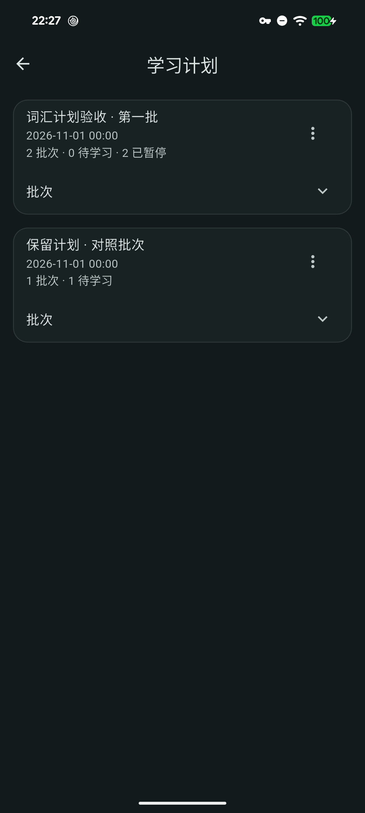

# 学习计划整组管理（+70候选，2026-11-10）

1.8.2+70／schema17，依赖锁保持；接续已发布1.8.1，推进阶段49的一项完整本地工作流。

## 已实现

学习计划编辑器、复习与每日练习的文件夹按钮进入计划列表。卡片展示批次、待学习与暂停数量，展开可查看各批状态；三语、窄屏和大字体适配。导航保留未提交的生成偏好／预览，生成和保存中禁用入口。恢复后旧页面不得写入新数据代次。

暂停与继续仅修改可见、未完成的批次；已完成、归档、原回收站批次保持。词条进度、复习日期、附件引用和原件保留；用户手动设置过周期的学习批次，整组继续也不自动顺延日期或补发过期系统通知。移至回收站前列出批次，确认后软删除，未永久清理学习历史及原件。

整组成员及其全部字段在同一SQLite事务内与预览比较：新增、编辑、移组、移除和意外子任务均使陈旧操作失败。任一写入失败全部回滚，不提前发布界面状态或发送通知；业务提交后同步通知，失败报告为已保存但通知待修复。普通任务的生命周期及周期继续规则保持。数据使用既有study_plan_id／paused／deleted_at字段，无新增schema。

## 自动化与实机分别记录

- 本地SDK3.47.2完整Flutter2384通过／20跳过、Python161运行／6跳过，发生于最终暂停摘要和旧周期继续修复前。最终相关86通过、分析0；包含事务第二写失败回滚、整组成员并发变更拒绝、恢复代次、通知失败、学习队列、非空词条进度重开、附件字节／记录保持和三语布局。最终固定SDK完整CI另验，不把此前完整计数转记最终源码。[本地证据](benchmarks/study-management-70-local-2026-11-10.json)。
- 初次类型检查发现历史createdAt可空，现未知日期不显示虚构日期；过时的跨async上下文访问已加mounted／代次检查。旧周期学习批次继续原本把2026-01-08顺延至2026-11-11，先复现再加入组级日期保留回归。实机成功横幅遮住首卡菜单，移除重复成功横幅，以列表状态变化反馈，错误与通知修复提示保留。
- Pixel独立临时身份、仅合成3行：真实点按整组暂停／继续／确认回收站，另一个计划不变；历史周期批次日期保持，全部行留存且冷重开读回。暂停数量已显示，页面截图已查看。初次脚本未等待交互恢复，保留检查点后续验通过；最终完整触控再次通过。临时身份已卸载，用户的正式版与QA47未被清除或重装。[原生夹具证据](benchmarks/study-management-70-android-2026-11-10.json)。
- 临时入口使用实际页面和Android SQLite，但通知传输为记录替身；6次记录只证明取消／排程意图，不能写作系统送达或通知按钮通过。下图全部是合成内容，仅用于文档，不打包到App。

## 待完成

固定源码CI、普通Windows运行中覆盖及最新数据／凭据／文件核对、普通Android同签名更新和三端发行包门禁另行补记。独立夹具不替代普通App安装或真实系统通知验收。

46 USB长期；47普通包、IME／通知休眠／录音中断及WindowsGUI；48真实带附件设备往返、凭据故障／磁盘满／断电／保留与原声压缩；49跨计划调整、负担预测、档案与词条身份迁移、图片分享、LAN编辑／删除／附件／冲突及更多学习排程；50候选门禁后发布1.8.2，Apple、独立ARM64、正式签名和商店继续。

## +70候选收口

固定源码`08009a7961fbb73ec021dc04bd2430ffc391866c`的[CI42835644410](https://github.com/yarnway/dontforget/actions/runs/42835644410)七项成功：Linux Flutter2403通过／2跳过、Windows2385通过／20跳过，Python两端161运行（4／6跳过），五份artifact归属核对完成。Windows运行中+69→本地+70及双Android各自新备份后+69→+70、全字段／附件／安全条目保持及普通入口冷重开完成。[CI](benchmarks/github-ci-candidate70-2026-11-10.json)与[安装证据](benchmarks/candidate70-local-upgrades-2026-11-10.json)分开记录。+70未发布；用户追加文案精简后推进[+71候选](UI_Copy_Polish_71_2026-11-10.md)，最终包及新源码门禁另验。
