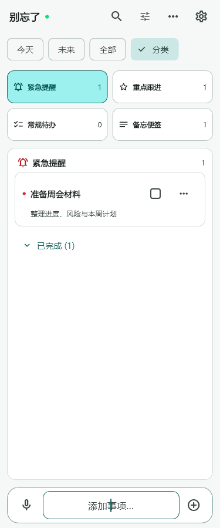
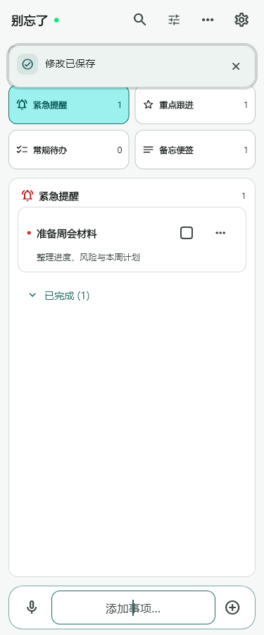
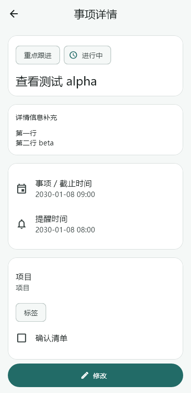

# 首页与只读详情：下一轮界面基线

来源为设置／关于优化源码`00cb603537b1a409b3edcd47ff1855f95ae4e6da`。本页为本轮Flutter测试引擎、合成数据和通知替身的现有界面观察，非Windows原生或iPhone截图，不是完整真实用户体验审查。首页与详情源码本轮未改。

## 1. 首页正常状态

375×900，实际MyApp／TaskBoard组件，合成事项。日期范围与四类入口可见；录入固定在底部，事项完成和更多操作独立。

## 2. 首页反馈状态

相同宽度与合成事项，测试显式显示“修改已保存”。此帧的反馈占用日期范围一行所在的区域，分类第一行与反馈边缘相邻。静态帧只证明这个位置关系，不能据此断言原生实际持续时间或用户操作受阻。

下一批先验证反馈自然消失的时间、窄窗下筛选与关闭按钮可达性、焦点是否保持，再决定是否改位置／尺寸；保留撤销入口，不把提示从悬浮改成推动输入布局。

## 3. 只读事项详情

390×800，实际TaskDetailScreen组件。标题、正文、时间和元数据分组，底部“修改”明确。只读状态没有TextField或Checkbox交互控件，四份视口／主题截图前后三张业务表保持一致；私有派生夹具复用既有离线测试支持，未改产品页面。

本轮只读详情／既有语音手势／离页编辑保护34项回归通过；原生触屏、真实读屏与键盘仍独立待验。[分层基线回执](benchmarks/ux-next-surfaces-baseline-2026-11-16.json)。

## 下一批顺序

1. 首页反馈自然时序与筛选、输入焦点；长标题、多事项、空态及两种布局的操作密度。先复现问题，再改布局。
2. 详情长正文／多附件的阅读密度与返回位置，大字和小屏；保持默认只读与明确“修改”，不将整个详情改成表单。
3. `assets/app_icon.png`仍为Flutter占位图标，统一品牌资源时同时覆盖关于页与各平台启动图标，不能只改其中一处。
4. 将源码优化纳入新构建号，保全并验证Windows运行中升级与iPhone同身份升级；Pixel恢复接入后补Android正式／QA。原生窗口工具仍受cwd URI错误阻塞，渲染不能替代GUI／VoiceOver验收。

本轮已实施内容及对照见[设置与关于页](UX_Settings_About_2026-11-16.md)，完整待办见[阶段台账](Next_Steps_2026-11-02.md)。

## 本轮后续收口

上述图为00cb603最初基线，不代表当前83界面。首页浮层时序已随[文案优化](Product_Copy_2026-11-16.md)收口；详情阅读与独立更新播报见[本轮对照](UX_Reader_Accessibility_2026-11-16.md)，已随[83发行](Release_1.8.12_83_2026-11-16.md)。首页更复杂密度、品牌资源与完整原生读屏仍为后续任务。
