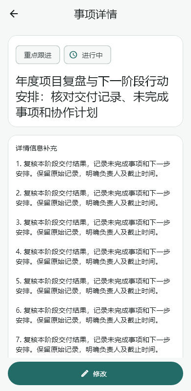
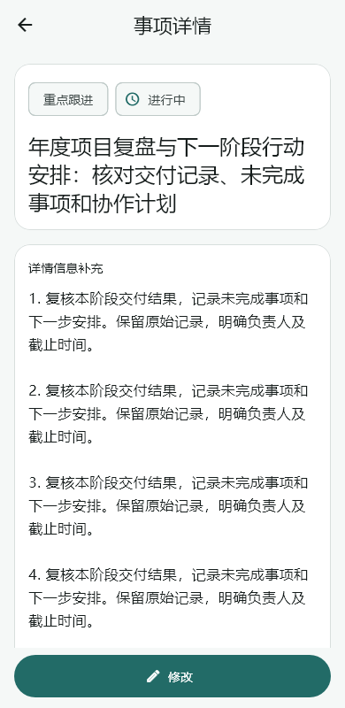
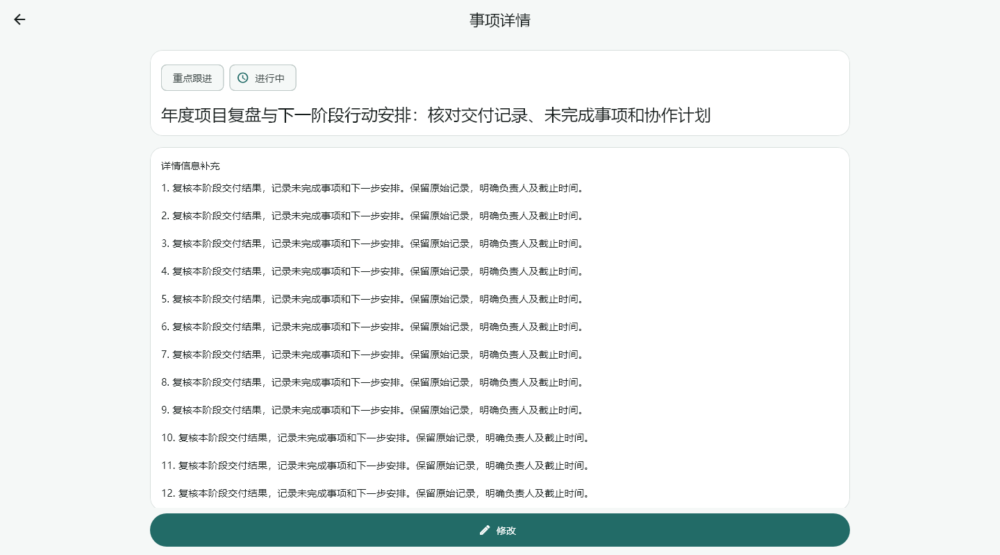
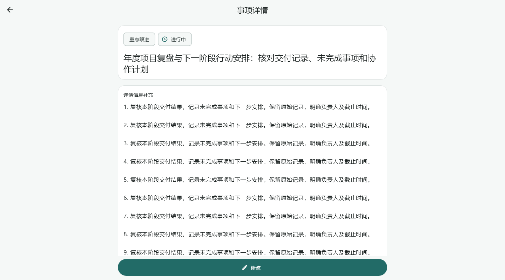
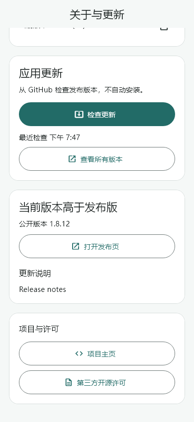

# 详情阅读与更新播报：源码优化

本轮源码`f3fdbdbe144a024f8145b0c089800b9dcd7a8f48`，独立分支`codex/reader-ux-accessibility`，基于build82发行来源`1c9aa15`。这是源码与组件验收，尚未合入main、运行本轮固定云端CI、生成新包或安装；公开正式版仍v1.8.11+81。后续包含本改动的候选必须增加构建号，计划build83，不覆盖既有82候选或把其真机结果换记新源码通过。

使用Product Design审查流程，先捕获并查看本轮当前代码的渲染，再实施小范围调整。下图均为Flutter测试引擎、实际字体及合成事项；不是Windows／Android／iPhone原生截图，不是完整原生体验或无障碍合规审查。关于页模拟的版本只用于验证比较状态，不表示已构建或安装该版本。

## 1. 打开并阅读详情：已优化

本轮390宽截图显示，原正文使用较小的默认文本与紧凑行距；1440宽时内容列上限1040。调整为主题bodyLarge与1.6倍行高，详情补充和展开的原始记录保持一致；桌面内容列收至800，底部“修改”与内容卡片同宽。窄窗继续自然换行，保留系统文字缩放、文本选择和默认只读。

以下为同一合成事项、相同视口的修改前后。更大行距会增加滚动长度，换取较清楚的长段落阅读；没有缩小大字或折叠用户正文来强行放进首屏。

| 视口 | 修改前 | 修改后 |
| --- | --- | --- |
| 手机390×800 |  |  |
| 桌面1440×800 |  |  |

## 2. 大字滚动并进入修改：组件验证通过

320宽、200%文字下，长标题仍会占较多首屏空间，正文自然滚动；末段可滚动至内容视口内，底部“修改”保持可见。本轮不通过限制系统字号来压缩标题。新增长内容回归还验证原始记录展开、滚动前后修改按钮几何一致、可进入编辑，且Reminders／MediaRecords／Settings所有字段保持；默认阅读时没有TextField或可切换Checkbox。

原有中英日、明暗主题、200%缩放、只读键盘保护、附件原件、编辑返回及数据代次保护回归均在本轮相关集内。真实软件键盘、文字选择菜单、TalkBack／VoiceOver及触控仍需设备验收；静态截图不证明这些行为。

## 3. 手动检查更新：播报边界已修复，原生仍待验

build82原生观察中未读到结果标题，不能仅据此判断视觉标题消失。本轮重新渲染，标题视觉正常；进一步读取组件语义发现状态“发现新版本”与“更新说明”合为一个节点，较新候选状态在三语中也有同类合并。对原始1c9aa15页面运行新增语义契约，实际标签为`发现新版本\n更新说明`，断言按预期失败，保留日志；不是将编译失败当作缺陷证据。

对成功结果和失败提示建立独立语义容器，结果继续保留标题与liveRegion，错误保留liveRegion。三语组件回归确认新版本／高于发布版的标题标签独立，错误不混入说明和检查时间，失败时不出现“已是最新”。本轮没有自动联网或自动安装行为变化。

这修复的是可复现的组件语义合并；尚未在Pixel复验原生树标题，也未听取实际读屏输出，不能记为Android原生缺失已解决。

## 验证、包与设备边界

- 固定隔离Flutter3.44.9／Dart3.12.2，5文件76项通过／0跳过，静态分析0问题；其中3项新增行为测试，未删除断言或增加跳过。
- 首轮新增夹具的旧中文定位错误、第二轮滚动后未等待布局完成、基线对照夹具的相对／package导入身份冲突均已保留，分别修正后再验。基线语义契约的预期行为失败与这些夹具失败分开记录。
- 两项源码渲染观察通过，阅读前后三表保持；本轮6张选定截图均在本轮捕获并查看，没有复用旧轮次截图作新审查证据。[分层回执](benchmarks/ux-reader-accessibility-source-2026-11-16.json)。
- 本轮USB只读元数据仍为iPhone独立身份1.8.11／81，Pixel当前未连接。没有安装新包、改配对或凭据；上轮手机81最新备份与Windows／双Android82保全升级保留[原归属](Release_1.8.12_82_2026-11-16.md)。
- 当前免人工iPhone升级路径未新增可用能力：已有未签名IPA需要个人重签，Windows界面工具初始化故障未解除。自动续签旧版本不等于安装新二进制，不以后台进程存在冒记升级成功。

## 下一批

将本轮源码纳入新构建号后，完成固定云端CI与完整包核对；每个新Windows版本重新取最新备份并运行中正常覆盖、核对全字段／DPAPI／普通重开；Android正式／QA分别取最新备份升级，iPhone同身份安装并验证全字段／媒体／偏好与关于页，再进入发行和公开更新读回。旧82候选保持不可变，不能直接作为本轮新源码包发布。

阶段47还需首页密度、统一品牌图标、原生更新标题／通知／录音／读屏；46 USB长期与休眠；48容量／真实故障／凭据锁定／外部保留；49迁移／图片分享／同步冲突；50签名续期／当前候选升级发行及商店。详见[阶段台账](Next_Steps_2026-11-02.md)。

## 后续发行与原生收口

以上为f3fdbdb源码阶段的审查快照；随后同一lib树合入ffdfa5a／build83，固定CI七项成功、四平台包与发行读回完成，Windows运行中和双Android最新保全升级通过。Pixel首次检查超时保留，发布后复查实际current、标题原生树可见并返回首页；不冒记TalkBack播报或iPhone已升级。[83最终记录](Release_1.8.12_83_2026-11-16.md)。
