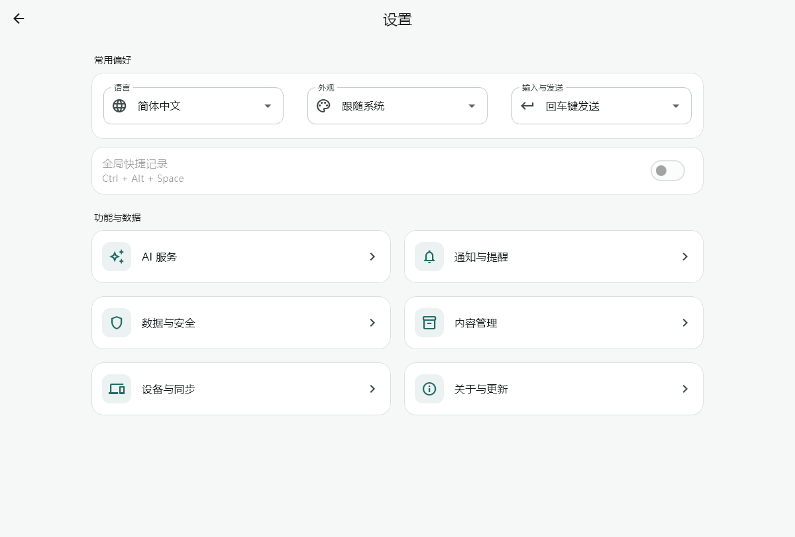
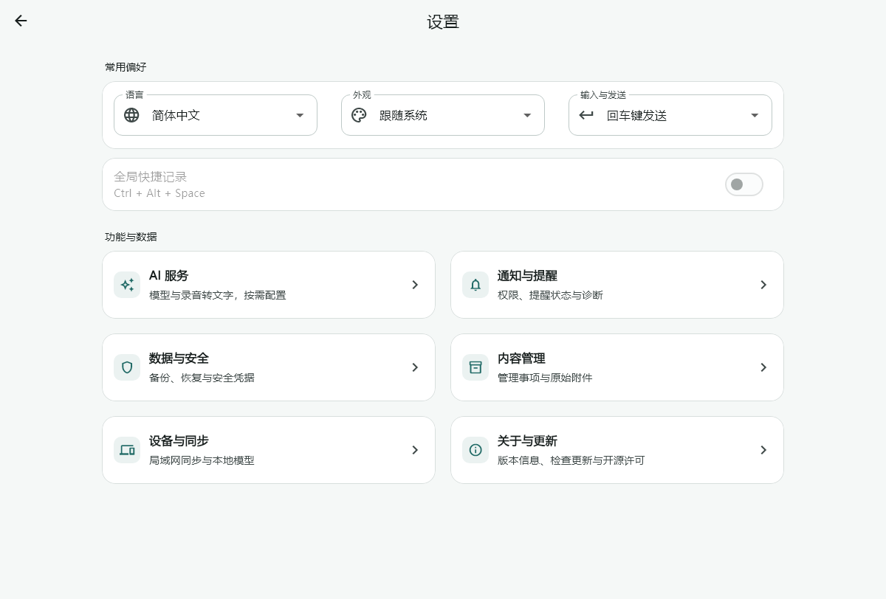
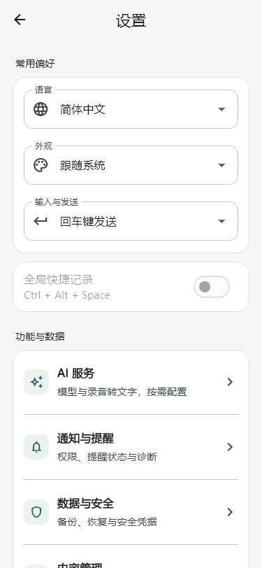
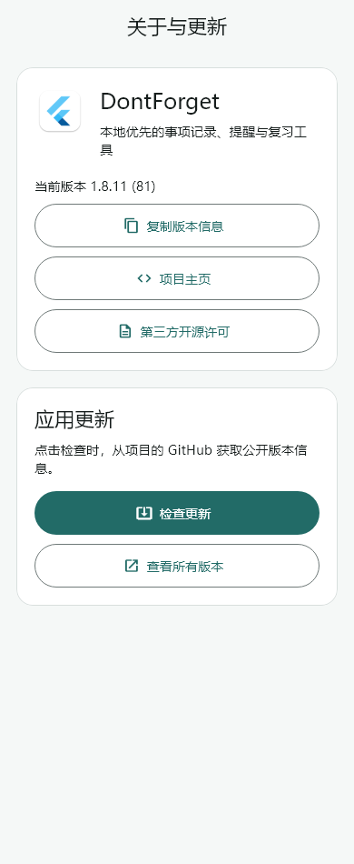
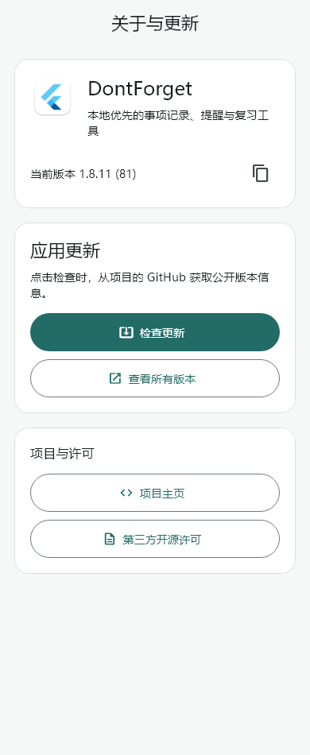
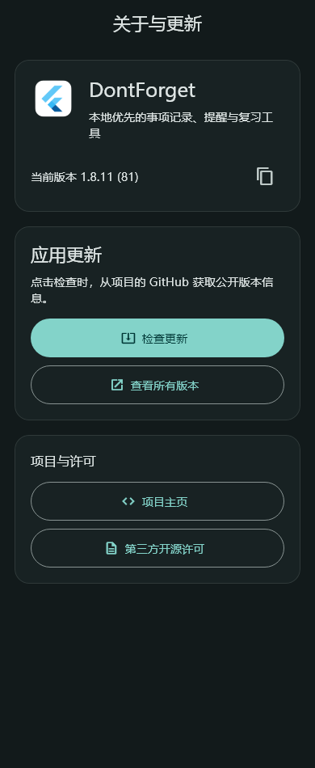

# 设置与关于页：可读性、入口说明和更新路径

本轮响应继续推进和UX／UI优化要求，先完成设置与关于页两处源码迭代。正式发行仍为v1.8.11／build81、源码ae11fd6；本轮未修改版本号、依赖或schema17，未安装新包、覆盖手机或修改旧Release。后续发行须分配新构建号，重新保全并验收Windows运行中升级及iPhone同身份覆盖；不使用本轮源码CI候选替换已发布的81附件。

## 当前页面渲染对照

下图为本轮从实际Flutter页面组件生成的测试引擎渲染，使用临时合成数据库、模拟安装元数据及微软雅黑字体，不是已安装的Windows窗口或iPhone截图。Windows窄窗图仍显示Windows快捷记录入口，不代表iOS也显示该入口。

Windows computer-use在初始化时仍报`sandboxCwd is not a local file URI`，没有取得窗口或执行输入。原生截图审查受阻，不将源码渲染、旧截图或自动化替身写成真实设备审查通过。

1. **设置入口：源码渲染及回归通过，原生待验。** 原页面只有功能名称，用户需进入后判断用途。六入口补充三语简短说明，标题稍加强调，图标尺寸与间距统一；桌面保持双列，窄窗／大字改为单组列表，减少重复边框和卡片间空隙。大字模式省去装饰性前置图标，为标题和说明留出宽度。

优化前，1200×812：

优化后，相同视口和合成状态：

窄窗布局，375×812：

2. **关于与检查更新：源码渲染及回归通过，原生待验。** 原页面先排复制信息、主页、许可三个完整按钮，再出现更新操作。将版本复制收进版本行，保留48×48点击区域、长按／悬停提示和可读语义；主页与许可独立放在更新之后。三语375×568正常字号下，检查更新无需滚动即可完整显示；未对大字模式承诺固定首屏，继续允许正常滚动。

优化前，390×950：

优化后，相同视口和模拟安装版本：

暗色版本：

3. **检查结果与失败恢复：自动化通过，读屏设备待验。** 仅对更新结果标题和错误提示增加live region，使辅助技术可获知变化，避免把整篇发行说明作为一次播报。手动触发、失败重试、复制链接、离页晚回调、未保存偏好、业务与凭据保全沿用既有行为并回归；不称VoiceOver／TalkBack已实测。

## 验证与证据

固定隔离Flutter3.44.9／Dart3.12.2：七文件相关106项通过／0跳过，覆盖三语、明暗、大字、窄窗、异步生命周期、脏偏好与凭据保全、公开更新解析及错误恢复。新增短屏首屏检查和版本复制的语义／触点／实际值回归，保留48组跨平台更新布局组合。两个源码预览用例另行以真实字体执行通过；静态分析0问题。[源码与渲染回执](benchmarks/ux-settings-about-source-2026-11-16.json)。

首次新测试误将tooltip语义当成label、SemanticsHandle清理过晚以及尚未构建的离屏项目直接定位，均为测试夹具问题，修正后完整相关集通过；失败日志保留。首次暗色预览的图标尚未解码，弃用该图并增加显式precache等待后重新生成、检查，未将空白图当成最终证据。

固定CI状态在回执和[阶段台账](Next_Steps_2026-11-02.md)另记。源码、自动化、安装包和真实设备分开：本轮没有新包升级或新发行，不能将既有81的Windows／iPhone成功结果移记到本轮新UI。

## 后续顺序

- 阶段47界面下一批：用当前首页和只读事项详情渲染检查层级、空态、长标题与操作密度；保留明确“修改”和既有语音手势。应用图标当前仍为Flutter占位资源，后续统一设计并替换各平台资源，避免只改关于页导致身份不一致。
- 阶段47原生：Windows工具恢复后补真实截图／键盘／焦点、Toast／托盘；iPhone补触屏、VoiceOver、通知／录音／灵动岛；Pixel接入后补新版正式与QA保全升级。
- 阶段46自然USB／休眠／跨主机，48容量／真实故障／凭据锁定／文件保留和目录，49迁移／个性化／图片分享／LAN冲突继续单独推进。
- 阶段50下一候选：新构建号、固定CI及完整包核对，Windows最新保全运行中覆盖、iPhone最新保全同身份覆盖，再按设备可用范围发行；个人签名续期、macOS公证、Windows签名商店继续待办。
