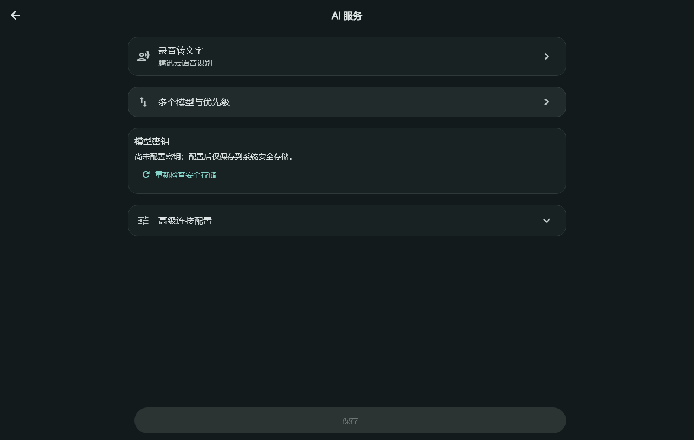
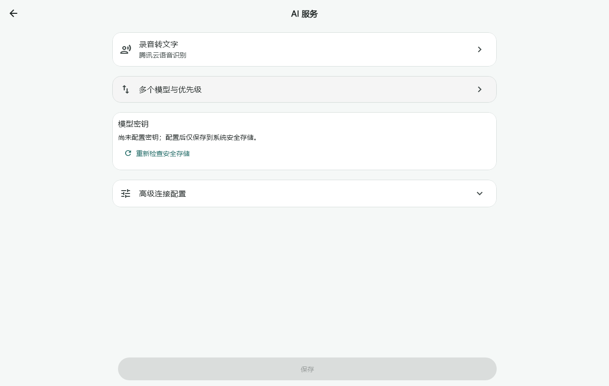

# 升级退出与跨平台配置卡片（+67候选，2026-11-10）

1.8.1+67／schema17，依赖锁不变。本轮接续1.8运行中覆盖失败，并按用户截图修复配置卡片的矩形交互叠层和间距。

## 源码

Windows原生窗口接收RestartManager的WM_QUERYENDSESSION／ENDSESSION_CLOSEAPP时只返回同意，不提前退出；确认的WM_ENDSESSION才通知Dart。普通关闭仍到托盘。Dart合并重复请求，录音、准备录音、转写／后台处理、数据恢复或其他编辑页面打开时暂缓退出。先停止快捷入口并排空最新草稿（包含等待期间追加的写入），再暂停生产者、LAN和通知，关闭数据库及窗口。准备失败不进入退出，避免草稿尚未落盘就被恢复门禁丢弃。参考[微软退出流程](https://learn.microsoft.com/en-us/windows/win32/rstmgr/guidelines-for-applications)。

公共CardTheme启用圆角裁剪，包含悬停／点击背景；AI设置的语音、模型优先级与凭据卡片之间保持20逻辑像素间距。偏好、语音凭据、模型表单及连接区间距一并调整；三个旧装饰容器改为真正的圆角Material卡片，高级连接不再叠加第二层背景框。没有按Windows条件分支，因此修复适用于Windows、Android、Linux、iOS和macOS共享页面。

## 分层验证

- 本地Flutter3.47.2：完整2358通过／20跳过，Python161运行／6跳过、分析0；配置相关62通过。完整发现测试文件后新增的五个平台测试单独5通过，覆盖5平台主题×2宽度×2亮度×2字号，共40组。原完整运行的源码与测试快照未变，不将新增5项伪记在原2358中；最终CI另验。[本地证据](benchmarks/upgrade-settings-67-local-2026-11-10.json)。
- 相关退出／路由34项早期专项通过；最新“等待期间追加草稿也必须排空”竞态已纳入最终完整回归。最初一处括号风格提示已修正。跨平台测试最初在FakeAsync内等待真实SQLite初始化而阻塞，改为real I/O测试夹具后通过，仅停止了自有测试进程。
- 真实RestartManager隔离原生入口正常关闭328ms、未强关，顺序ready→prepared→closed，夹具草稿在存储关闭前落盘。只针对自有进程，不代表真实MyApp／本机事项／正式安装器已经验收。[原生链路](benchmarks/windows-upgrade-exit-67-native-2026-11-10.json)。
- 窄屏／大字、深浅主题、配置保存与页面切换回归通过；悬停像素检查确认圆角外保持页面底色。下方为合成配置数据的组件渲染，包含模型入口悬停，非Windows或手机实机截图。图片仅用于文档，不打包到App。

## 包与设备

本机候选Setup／Portable与固定源码f3766d3对应，38项payload和PE1.8.1.67核对通过；先从已退出的1.8.0+66覆盖到+67，再在+67实际运行中正常覆盖同版。两次均新备份，4事项／0媒体／1设置全部字段和凭据文件保持，安装器退出0、未允许强关，CLI冷读回后重开。运行中这一项为+67同版覆盖，不冒记旧+66运行中迁移。[本机证据](benchmarks/windows-local-upgrade-67-2026-11-10.json)。[固定源码CI42783828681](https://github.com/yarnway/dontforget/actions/runs/42783828681)七项成功，Linux2381通过／2跳过、Windows2363通过／20跳过，Python两端161运行（4／6跳过），五份来源包可追踪，正式1.8.1发布改由后续+68接续宽度对齐及安卓卸载验收。旧1.8.0进程没有新处理逻辑，首次装修复版仍可能需用户从托盘退出；随后应另验新版运行中的覆盖安装。不能把退出后成功移记为运行中成功，也不能把同版本覆盖移记为未来跨版本迁移。

其他终端的公共源码与平台主题布局模拟已覆盖；真实Android／iOS／macOS／Linux桌面、输入法和系统交互继续分平台记录。computer-use工作目录URI错误未解决，普通WindowsGUI／托盘／Toast不冒记通过。

## 剩余阶段

46 USB长期／跨主机；47本轮本机覆盖与运行中验收、其他机型／IME／通知休眠和录音中断、普通GUI；48带附件设备往返、凭据锁定／重新授权、磁盘满／断电／保留管理及原声压缩；49图片文件分享、LAN编辑／删除／附件／冲突、学习排程；50本轮固定源码与包门禁后发布1.8.1，独立ARM64、Apple设备／签名和Windows正式签名／商店继续。
