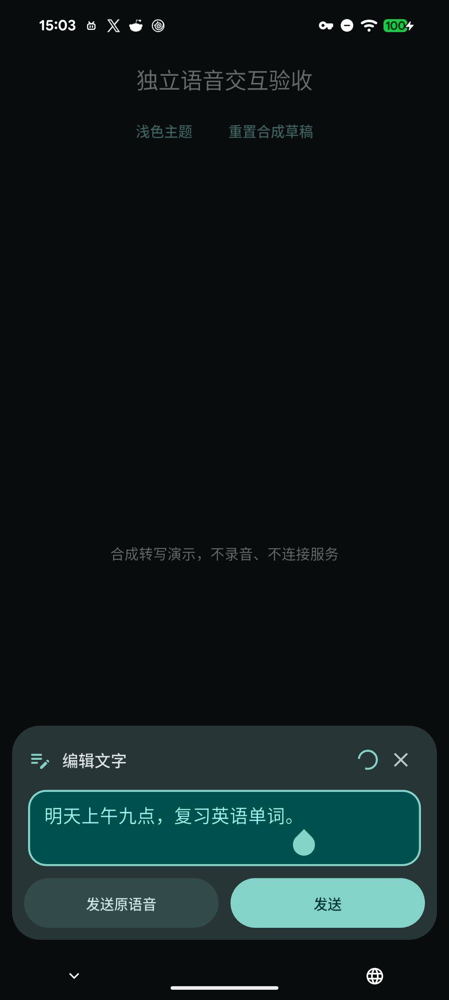
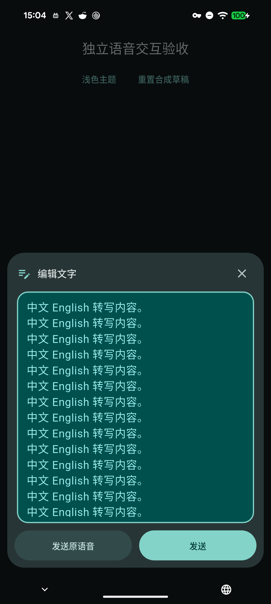

# 语音转写编辑与原声发送 · +77

## 行为

长按录音、上滑右划并松手后，打开可编辑的转写面板。短文保持较小高度，文字增加时展开，达到可用高度后框内滚动；底部提供“发送原语音”和“发送”，右上角关闭并保留文字草稿。极短横屏键盘空间改用带语义标签的操作图标。

“发送”明确提交当前显示文字，无需等待迟到的最终识别；中文组合态禁止发送，Enter保持换行。“发送原语音”保存本次录音，保留录音前已有文字草稿，避免把本次转写再次提交。保存时禁用重复操作，失败保留编辑内容并允许重试。

录音由独立会话持有到选择完成；原声复制／关联媒体成功后才可释放，识别仍在读文件时延迟清理临时文件。原声及媒体身份在重试时保持；识别失败关闭面板沿用原声保全策略，已发送文字不额外生成失败录音备忘。短音频及恢复代次失效不写入新数据。腾讯识别上传时机保持从按住录音开始。

 

## 分层验证

- 源码：1.8.8+77、schema17，无新依赖。原有桌面听写入口保持；本次可选原声编辑面板用于Android／iOS。
- 本机SDK3.47.2：最终相关228项通过、分析0；包含三语、小屏／横屏、大字、模拟键盘、编辑器身份／组合态、动态增高／缩小、显式文字发送、原声互斥／失败重试。真实PCM WAV／SQLite验证原声数据一致、迟到识别、短音频、恢复拒绝及媒体写入后备忘事务失败的同身份重试。
- 首轮测试夹具未及时监听错误Completer，另一个在文字模式长按非空草稿未切语音模式；修正夹具后复验通过。早期分析的初始化参数及花括号提示已修正。日志保留在本地build/stage95，未以失败轮次记为通过。
- 最终来源的Pixel合成布局／交互、固定SDK完整CI与普通Windows／双Android升级分别完成，见[发行记录](Release_1.8.8_77_2026-11-13.md)。本机文件与合成转写不替代真人录音、软件IME或云端时延。
- v1.8.8+77已发布；本版新做76→77保全升级，不移用+76历史证据。
