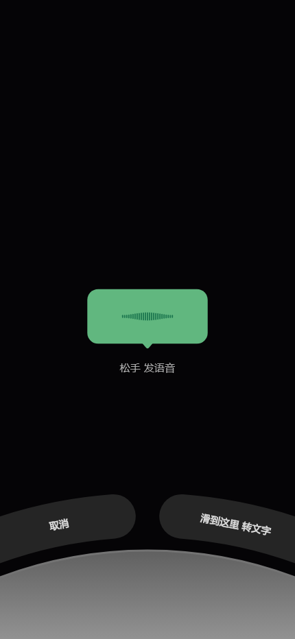
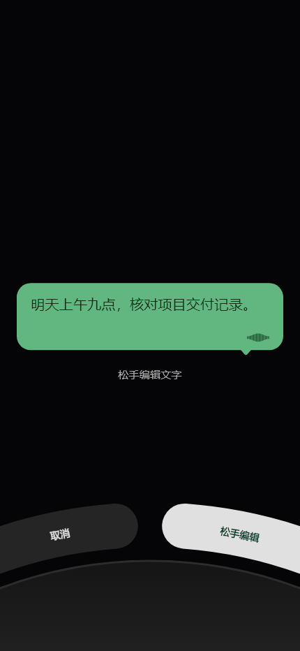

# 语音输入三态（2026-11-17）

用户提供录音、上滑右划转文字、转写后编辑三张参考。本轮在现有Flutter实现上优化，候选版本1.8.13+84／schema17，公开版仍1.8.12+83。源码、自动化、安装包和真机各自记录，不把83旧通知／录音矩阵记作84通过。

录音保留波形气泡与取消／转文字手势目标；转写改为同一绿色气泡展开，文字滚动到最新部分，松手进入同色可编辑文本。编辑态保留发送原语音、发送、失败重试及原草稿保护，默认录音手势和继续右滑发送保持。服务配置、凭据、存储schema和依赖不变。未追加翻译服务。

修复“按住说话”标签重复及语义范围扩散：本轮83真实UI观察到其范围为整屏，新组件建立独立边界。对旧ffdfa5a运行新增契约，精确单标签断言失败；修复后单标签与输入板尺寸通过。实际TalkBack／VoiceOver仍待验。

视觉证据与范围见根目录[design-qa.md](../design-qa.md)。用户含聊天内容的参考和对照仅存于忽略目录；公开记录只包含合成文本的Flutter渲染。真实系统键盘、麦克风、识别结果和各平台候选另验。

最终本机11文件174通过／0跳过、分析0；三态渲染与编辑发送观察通过，组件视觉复核通过。[脱敏回执](benchmarks/voice-three-states-source-84-2026-11-17.json)。固定CI、包与设备验收仍分别待验。后续先补最终检查与Pixel三态原生链路，再按发行策略核对四平台包，Windows每版先最新备份、运行中正常覆盖及业务／真实凭据／重开保全，双Android分别取新基线；iPhone继续按工具实际能力保留待验，不自动处理Apple认证。

| 录音 | 滑动转写 | 编辑（键盘避让） |
| --- | --- | --- |
|  |  |  |

以上为本轮最终源码、合成文本、测试引擎截图，不是手机或系统键盘截图。
