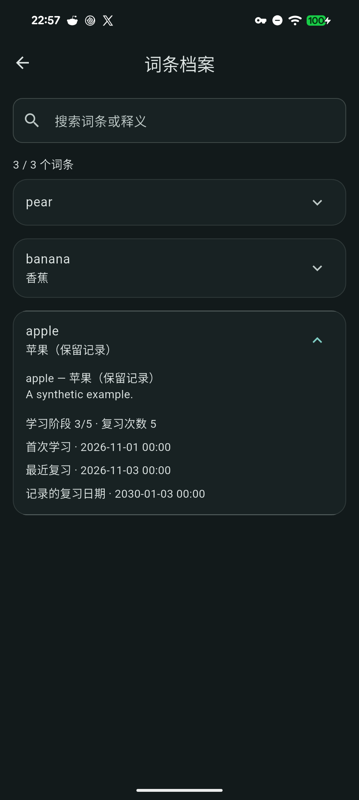

# 词条档案：只读浏览与检索

阶段49源码迭代，尚未随正式安装包发布。当前稳定版仍为v1.8.6／build75；本轮未改变版本、schema17或依赖，未覆盖普通Windows或双Android应用。

## 行为

在“学习计划”右上角或“学习管理”概览打开“词条档案”。仅展示已有反馈的词条，按最近复习排序；支持词条、释义和例句检索。展开可阅读、复制原词条说明，以及学习阶段、复习次数、首次学习、最近复习和记录的复习日期。

沿用学习队列的全局进度合并规则：后续复习优先，同次复习采用较新的手动改期。暂停、归档、回收站和保留历史中的记录继续纳入；词条说明被更正或缺失时，历史仍以原身份展示。记录的复习日期不代表当前存在有效排程，未自动安排提醒、修改学习反馈或迁移词条身份。

彻底删除来源或清理已完成事项时，说明缺失／被改为其他词条的旧词进度仍先保留；已有的旧词说明继续沿用，不虚构释义，也不把旧词进度自动转给新身份。归档写入失败时，来源删除一并回滚。
列表默认收起，使用惰性构建、统一宽度与间距并裁剪卡片交互背景。搜索内容只保留在当前页面；同一数据快照复用解析结果，记录变化后刷新。损坏进度明确显示读取失败，不显示为零条或自动重写数据。

学习管理页使用现有“未来7天”卡片替换重复统计，统一逾期归入今天、共享词条去重和今日已学习额度的口径；仍是当前排期概览，不模拟未来反馈。

## 验证分层

- Windows本机原生Flutter3.47.2：相关103项通过、分析0，覆盖档案合并与检索、全业务表不变、无原生提醒调用、实时刷新、损坏记录、两个入口及中英日文375／1280宽度和大字号。
- 首轮测试在学习管理异步草稿恢复前调用动画等待，出现超时；改为等待实际恢复完成，复验通过。首轮未使用导入的分析告警已移除，日志另保留。[源码证据](benchmarks/word-archive-source-2026-11-12.json)。
- 首轮只读Pixel独立身份、本机SDK3.47.2：5条合成事项／1原件／1设置，实际展开最新保留记录、检索及清空检索、学习计划与学习管理两入口、无词条说明的历史展示和新PID冷重开通过。业务表全字段、原件摘要保持，原生提醒意图0；输入法设置保持，临时身份已卸载，普通正式／QA未重装或清除。文字由ADB硬件注入，不据此认定软件IME或系统通知送达通过。[独立实机](benchmarks/word-archive-native-2026-11-12.json)。
- 补齐旧词保留保护后，最终独立Pixel夹具已重建，触控／实际删除保留及固定SDK完整CI重新验收；本轮普通发行包、Windows运行中覆盖及正式Release均未执行，不挪用已发布+75结果。

后续：档案清除及词条身份更正迁移、动态学习预测、更多练习排程、图片分享与LAN冲突。阶段46长期USB／跨主机，47真实IME／系统通知／录音中断与Windows GUI，48带附件GUI恢复／真实存储故障与保留策略，50下一轮三端升级发布及Apple签名／商店，继续分别记录。
