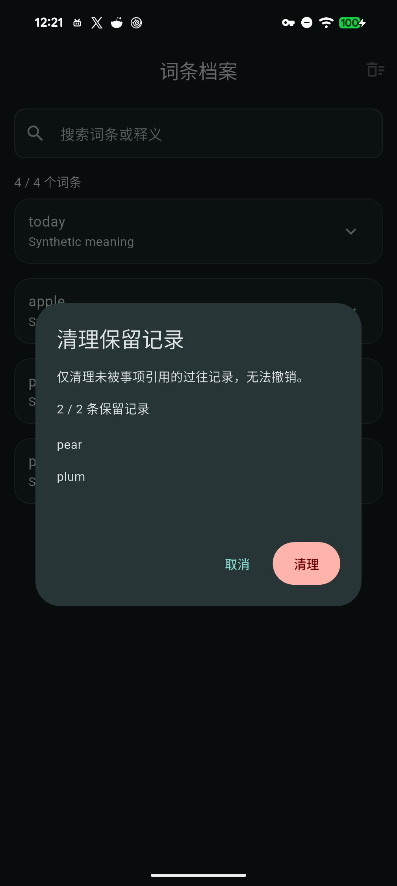

# 保留档案清理

阶段49源码迭代，基于已发布v1.8.7+76。版本、schema17与依赖保持，本功能尚未进入公开安装包；不替换已有发行附件。

## 范围

词条档案页增加“清理保留记录”。预览列出本次候选，按词条排序、单次最多200条；取消不写入，明确确认后整批清理。浏览和搜索仍保持只读，搜索条件不缩小全局清理预览。

仅清理应用在删除来源时生成、没有事项引用的过往保留行。任何事项（含归档、暂停、回收站及带历史标记的非标准事项）的词条说明或已有进度继续保护对应身份；今日复习／首次学习记录及未来时间记录保持。关联、附件、自定义元数据或非标准保留行也不会清理。当前事项、计划、学习进度、今日额度、媒体与设置保持；这不等于重置仍被引用的词条。

确认操作核对完整事项快照、候选身份及日期，并检查数据库与运行恢复代次。新增引用、编辑、删除、跨日或恢复后要求重新预览；写入失败整批回滚。直接删除专用保留行，不调用来源删除时的再归档逻辑，也不触发原生通知或文件清理。清理后SQLite可复用页面，未做VACUUM或原声压缩，不声称物理存储立即缩小。

## 验证分层

- Windows本机原生SDK3.47.2相关82项通过、分析0，包含实际来源删除所生成档案、冷读回、队列／额度保持、并发与恢复、失败回滚、只读档案和计划管理；初期编译夹具、无效词条样例、弹窗尺寸与分析告警留证后修正。非标准历史标记引用的回归测试先复现再修正。[源码证据](benchmarks/word-archive-cleanup-source-2026-11-13.json)。
- 独立Pixel、本机SDK3.47.2、源码cd04418：真实来源删除生成4条保留行，加当前计划／批次及带原件对照，共7事项／1原件／1设置；当前批次故意保留非标准历史标记。预览与取消全字段不变，确认只清理所列2行，当前批次、今日进度／额度、媒体／设置及原件摘要保持；清理无额外原生意图，剩余保护记录预览禁止确认；新PID冷重开一致，输入法设置保持，临时身份卸载。初始4次来源取消为通知记录替身，软件IME与系统送达另验。[实机证据](benchmarks/word-archive-cleanup-native-2026-11-13.json)。
- 最终[固定SDK CI](https://github.com/yarnway/dontforget/actions/runs/43364007389)七项成功：Windows analyze and test：Flutter2507通过／20跳过，Python170运行／6跳过；Analyze and test：Flutter2525通过／2跳过，Python170运行／4跳过。5份候选artifact来源与摘要元数据核对，未新下载普通候选包做完整字节／覆盖安装验收。[CI证据](benchmarks/word-archive-cleanup-ci-2026-11-13.json)。
- 初始1b7674f的基础实机路径通过，后发现非标准历史标记引用边界；新增回归先复现后修复。旧CI两端质量曾通过，五平台候选因最终源码取代而取消；最终源码重新完成本机、实机和完整CI，不复用首轮结果。[初始过程](benchmarks/word-archive-cleanup-initial-2026-11-13.json)。
- 本迭代未新覆盖普通Windows、Android正式或QA应用，未发布新版；前一轮v1.8.7的语音优化及三端升级发布见[发行记录](Release_1.8.7_76_2026-11-13.md)。

剩余：46 USB长期／休眠／跨主机；47 真实IME／中英文语音与云端延迟／中断／系统通知、长按预览无障碍和Windows GUI；48 带附件GUI恢复、真实存储故障、保留策略与压缩；49 受保护词条重置／身份迁移、动态预测、更多排程、图片分享／LAN冲突及普通包完整触控；50 下一版三端升级发布、Apple设备／签名公证、Windows Authenticode与商店。
